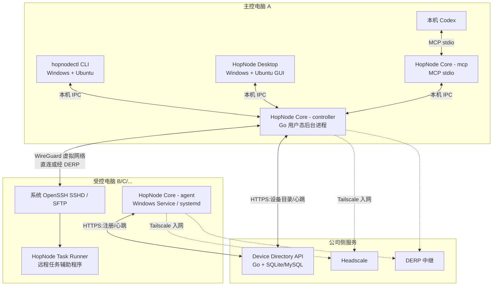

# 跃点 HopNode — 软件技术设计说明书（Design.md）

> **产品名称**：跃点 HopNode  
> **品牌口号**：跨越边界，连接无限。  
> **文档版本**：V1.3  
> **创建日期**：2026-10-18  
> **创建者**：ChatGPT（技术设计草案；正式入库后的代码文件作者信息以本地 `git config user.name` / `git config user.email` 为准）  
> **依据文档**：`PRD.md`（V1.4）  
> **文档作用**：明确技术选型、桌面端和后台服务架构、代码目录、UI 规范、跨网络通信、Codex MCP 接入、数据模型、构建发布、测试和开发顺序，为开发人员或 Codex 提供可执行的实现依据。  
> **状态**：技术设计建议稿。尚未实施，涉及系统服务、跨平台安装和版本兼容的事项必须完成 POC 后冻结。  
> **本次修订日期**：2026-10-18  
> **本次修改者**：以文件正式提交时开发者本地 `git config user.name` 为准；当前编辑环境未配置 Git 作者，不虚构署名。  
> **修订说明**：V1.3 补充快速 SSH / 托管组网、停止受控与设备撤销、进程身份及生命周期、SSH 配置与 Linux GUI Codex 定位、MCP 版本协商、GUI/Core/CLI 升级回滚及性能门槛；将 AGENTS.md 纳入仓库；继续强制交付 Windows/Ubuntu GUI + CLI + Service。

## 1. 设计目标与边界

### 1.1 一句话目标

在 Windows/Ubuntu 上运行跃点，支持已有 SSH 网络或托管组网；在安装 Codex 的电脑上发现并管理多台可操作设备，让 Codex 通过标准 MCP 接口，跨局域网或公网访问这些设备的文件、终端和任务；不要求每台受控电脑都安装 Codex。

### 1.2 首版交付要求

| 项目 | V1 范围 | 说明 |
| --- | --- | --- |
| 交付形态 | **Windows GUI + CLI + 后台服务；Ubuntu GUI + CLI + 后台服务** | 三类均为正式 V1 交付，不是普通网页 |
| 主控系统 | **Windows 10/11 x64、Ubuntu Desktop 22.04/24.04 x64；Ubuntu Server CLI 主控** | Windows/Ubuntu 均支持主控、受控、双角色 |
| 受控系统 | **Windows 10/11 x64、Ubuntu Desktop/Server 22.04/24.04 x64** | GUI 关闭后受控服务仍独立运行 |
| 桌面 GUI | **Windows 和 Ubuntu Desktop 同时正式交付** | 同一 React/Tauri 页面，Ubuntu GUI 通过 WebKitGTK 运行 |
| CLI | **Windows、Ubuntu Desktop、Ubuntu Server 正式交付 `hopnodectl`** | 与 GUI/MCP 共用 controller 业务 API；Ubuntu Server 无需桌面环境 |
| 工作模式 | 主控、受控、双角色 | 同一个安装包按设置启用角色 |
| 控制能力 | SSH、SFTP、命令、交互终端、文件、后台任务 | 系统 SSH 权限是实际执行边界 |
| AI 接入 | 本地 Codex + MCP stdio | 不将「自动发现 Codex」等同于「云端 Codex 已连接」 |
| 跨网络 | 快速 SSH 使用已有可达网络；托管组网使用 Tailscale + Headscale + DERP | 两模式共用 controller/GUI/CLI/MCP，均不自研穿透 |
| 公司侧服务 | 设备目录服务、Headscale、DERP | **仅托管组网模式必需**；快速 SSH 不强制部署，正式环境可拆开 |
| 首版不做 | 远程桌面、移动端、审批平台、多租户、云端通用 MCP | 不影响后续扩展能力 |

### 1.3 关键非目标

- **不开发新操作系统、SSH 协议、VPN 隧道、NAT 穿透算法或自研 UI 组件库**。
- 不直接把 Tailscale 节点列表当作「允许被操作的设备列表」。
- Ubuntu Desktop **必须**提供 GUI；Ubuntu Server 可以纯 CLI + systemd 运行，**不得因此取消 Ubuntu GUI 桌面产品**。
- 不通过浏览器网页承载受控服务，也不要求 GUI 窗口一直打开才能被控制。
- 不承诺绕过操作系统权限、系统服务安装授权、SSH 身份认证或 Codex 自身的批准机制。

## 2. 技术选型结论

### 2.1 推荐的正式技术栈

| 层次 | 最终推荐 | 作用 | 选择理由 |
| --- | --- | --- | --- |
| 桌面外壳 | **Tauri 2 + Rust** | 原生窗口、托盘、安装包、更新、本地进程集成 | 稳定的桌面产品路线，具备官方侧车、托盘与更新能力 |
| 桌面 UI | **React + TypeScript + Vite** | 界面、交互、表单、数据状态 | 社区成熟、便于 Codex 辅助开发、支持组件化 |
| UI 组件库 | **Ant Design 6** | 表格、导航、设置、抽屉、状态反馈 | 设备管理和配置界面组件覆盖全面，可通过 Token 做年轻化视觉设计 |
| 图标 | `lucide-react` | 轻量线性图标 | 保持清爽统一，不混用多套图标语言 |
| 终端显示 | `@xterm/xterm` + `@xterm/addon-fit` | 终端渲染与自适应 | 成熟终端组件；仅负责显示，不执行系统命令 |
| 前端路由 | `react-router` | 页面导航 | 单桌面窗口内的路由清晰 |
| 前端状态 | TanStack Query + Zustand | 异步缓存、UI 局部状态 | 区分设备实时数据和界面临时状态 |
| 包管理 | pnpm | 前端依赖与 workspace | 与 React、Vite 构建流程兼容 |
| 本地业务核心 | **Go** | 网络探测、SSH/SFTP、文件与任务、设备心跳、MCP、`hopnodectl` CLI | 对跨平台网络/系统服务、并发和 CLI 程序友好 |
| SSH | `golang.org/x/crypto/ssh` | SSH 认证、命令、PTY | 直接复用 Go SSH 库 |
| SFTP | `github.com/pkg/sftp` | 文件读写、传输 | 避免重写文件传输协议 |
| MCP | `github.com/modelcontextprotocol/go-sdk/mcp` | MCP 工具暴露、stdio 通信 | 采用官方 Go SDK，按固定版本开发 |
| 虚拟组网 | Tailscale 核心客户端 | P2P 与中继连接 | 不开发自己的 VPN 协议 |
| 协调服务 | Headscale | 设备入网和网络协调 | 自建、可自动化注册 |
| 中继 | DERP | 直连不可用时的退化路径 | 复用成熟基础设施 |
| 本地存储 | SQLite | 设备缓存、配置元数据、任务记录 | 单机轻量，无需额外数据库服务 |
| 公司目录存储 | SQLite（试点），必要时迁移 MySQL | 设备注册、在线状态、审计索引 | 先控制部署复杂度；不是把 Headscale 的库当业务库 |
| 本地通信 | Windows Named Pipe / Linux Unix Domain Socket | GUI、MCP 与后台核心之间通信 | 避免在公网或虚拟网络上暴露本地管理 API |
| 自动化 | **GitHub Actions + GitHub Releases** | 构建、测试、安装包、版本发布 | 与 GitHub 仓库、Pull Request、Release 直接集成；支持 Windows/Linux Runner |

**语言分工：**TypeScript 仅写 Windows/Ubuntu 共用 GUI；Rust 尽量只写 Tauri 宿主和系统集成；Go 同时承担跨平台 CLI、后台服务、远程操作及 MCP 的业务规则。不要分别用 Rust 和 Go 再实现两套 SSH/MCP 逻辑。

**版本策略：**Tauri 选 2.x 稳定分支，Ant Design 选 6.x 经测试的固定小版本，React、Go、Rust、MCP SDK、Tailscale 和 Headscale 均通过锁文件或发布清单固定版本；禁止在设计稿中写 `latest` 作为正式部署约束。

### 2.2 为什么不直接选 Electron 或 Wails

| 方案 | 优点 | 对跃点的代价 | 结论 |
| --- | --- | --- | --- |
| **Tauri 2 + React + Go** | 桌面生态较完整，官方支持 Sidecar、托盘、更新 | Rust + Go 两种原生语言，打包链路更复杂 | **推荐**，但 Rust 层保持极薄 |
| Electron + React + Go | Node/前端工程师易上手，桌面库充足 | 运行时体积和资源开销通常较大 | 可作为 Tauri 集成阻塞时的备选 |
| Wails v2 + React + Go | Go/TS 两条主线，语言栈更简化 | 常驻托盘、后台服务、发布升级需更多自行集成 | 有竞争力的备选，先做小 POC 再决定是否替换 |
| Wails v3 + React + Go | 具备更完整的桌面与服务方向 | 截至 2026-10-18 仍是 beta，生产版本有兼容风险 | 首版不以 beta 作为默认基座 |
| 纯 React 网站 | 快速制作界面 | 不能直接替代 SSH 主机服务、桌面托盘和原生安装 | **不满足软件交付目标** |

> **重要实现约束：**Tauri 的 Sidecar 是应用集成手段，并不等于开机常驻的系统服务。受控模式必须单独安装并托管 Go 后台服务，不能简单地在打开 GUI 时 `spawn` 一个子进程就声称支持无人值守。

## 3. 总体架构

### 3.1 分层结构



> 图是逻辑架构，不意味着 SSH 命令经过公司 Device Directory API 转发。目录服务负责发现和状态；数据平面是端到端 SSH/SFTP，依赖 Tailscale 打通路径。

### 3.2 进程及责任

| 进程/程序 | 安装位置 | 运行条件 | 负责事项 |
| --- | --- | --- | --- |
| `hopnode`（Tauri 桌面程序） | Windows / Ubuntu Desktop 主控或兼任受控 | 用户打开窗口时 | 同一 React GUI 页面、托盘、状态与设置，不直接执行远程 SSH |
| `hopnodectl`（Go CLI） | Windows / Ubuntu Desktop / Ubuntu Server | 命令调用期间运行 | 查询状态、配置角色、设备与网络管理、远程文件/命令/任务、诊断、服务控制；与 GUI 共享 Go controller，不另造业务内核 |
| `hopnode-core controller` | 主控设备 | 用户登录时自动启动，可后台常驻 | SSH/SFTP 会话、Codex 配置、凭据读取、操作记录和 MCP IPC |
| `hopnode-core agent` | Windows/Ubuntu 受控设备（含纯命令行服务器） | Windows Service 或 systemd 开机启动 | 角色开关、网络状态、设备注册、心跳、受控诊断 |
| `hopnode-core mcp` | 安装 Codex 的主控设备 | Codex 按 MCP 配置启动 | MCP stdio 协议端，调用 controller，不复制 SSH 核心逻辑 |
| `hopnode-core task-runner` | 受控设备（由已认证的 SSH 会话调用） | 任务启动时 | 执行和记录长任务；其跨断线存活能力须完成平台 POC |
| `hopnode-directory` | 公司服务端 | 常驻 | 注册、查询设备、心跳、备注、状态和服务器端目录 |
| Headscale / DERP | 公司服务端 | 常驻 | 虚拟网络控制面与中继 |

**运行身份边界：**主控 controller 使用登录用户的 SSH 配置和凭据；受控 agent 作为系统服务运行，不直接读取其他用户的私钥。真正的文件及命令访问由目标主机 SSH 已认证的账号执行，避免系统服务意外变成不受控的提权通道。

**双角色模式：**同一台电脑可同时启动 controller 与 agent，复用一个 `hopnode-core` 可执行文件，以不同子命令、配置目录和运行身份运行；两种角色不互相覆盖配置。

### 3.3 三类典型连接

1. **受控端安装跃点（托管组网）：**自动入网 → 自动上报目录 → 主控选设备 → 经 Tailscale 的 SSH/SFTP 操作。
2. **手动 SSH 设备（快速连接）：**用户填入已有 IP/域名、端口、SSH 凭据 → 直接走已有网络；没有 agent 的设备不具备自动心跳、受控开关和完整后台任务保证。
3. **Codex 操作设备：**Codex 启动 stdio MCP → MCP 请求 controller → controller 选定设备 → SSH/SFTP 或远程辅助程序 → 结构化回传执行结果。

### 3.4 安装模式与数据平面选择（正式约束）

| 维度 | Quick SSH（无需公司服务） | Managed Mesh（企业网络） |
| --- | --- | --- |
| 前置 | 可达的 SSH 地址/Host 别名和用户现有授权 | 配置好的 Headscale、Directory、DERP/公网访问和设备级注册材料 |
| 设备来源 | 手动设备配置；无 agent 心跳 | directory + agent 心跳、稳定设备 ID |
| 通信 | controller → SSH/SFTP（既有 LAN/VPN/跳板） | controller → Tailscale 虚拟网络 → SSH/SFTP |
| CLI/UI | 共用 `add-ssh`、设备和操作服务 | 共用设备和操作服务，增加 enroll/撤销状态 |
| 停止受控 | 未安装 HopNode Agent 的目标无法远程撤权 | 托管凭据/入口可撤销，不能直接关闭独立 SSH |
| 跨网承诺 | 仅现有路径可达时 | 受网络与中继服务可达条件限制 |

前端首启页默认提供清晰的两选项；不要强制用户先注册组织、登录个人账号或部署 Headscale 才能运行「快速 SSH」。设备数据模型增加 `source=manual_ssh|managed`、`capabilities` 和明确的离线/未托管语义，不能将手动 SSH 的“连接未检测”当设备在线。

### 3.5 进程身份与生命周期矩阵

| 情形 | Windows/Ubuntu GUI | 用户态 Controller（主控） | Windows Service / Ubuntu systemd Agent（受控） | 无 GUI Ubuntu Server |
| --- | --- | --- | --- | --- |
| 关闭窗口 | 关闭或托盘，按设置处理 | 保持运行（若已启动为独立用户进程） | 独立保持运行 | CLI 不受影响 |
| 用户注销 | GUI 退出 | **默认不保证持续运行**；Windows 用户会话结束通常退出，Linux user service 是否 linger 需部署决策和实测 | 开机系统服务继续（若实际启用） | 需明确定义服务化 controller 模式及其专用授权身份 |
| 机器启动 | 登录后启动 GUI（可选） | 登录后按用户配置启动；禁止偷用系统态 Agent 身份读取私人 SSH 凭据 | 服务管理器自动启动（启用时） | systemd 系统/专用用户服务按部署角色配置 |
| 服务崩溃 | 显示真实状态 | 管理器按用户态策略恢复 | SCM/systemd 重启与退避；不循环刷日志 | CLI 可诊断服务状态 |
| 升级/卸载 | GUI 可停止与恢复 | IPC drain → 停止 → 二进制/配置升级 → 健康检查 | 分开更新系统服务、验证身份与 socket 权限 | 不需要 GUI 或 `DISPLAY` |

**权限判定**：不同身份的 controller 与 agent 不得共享可读写的私人密钥目录；Windows Named Pipe/Linux UDS 必须以实际运行用户/服务访问控制保护。需要用户注销后仍可无人值守“主控”时，先提供专用服务身份和受保护授权来源的实施方案与 POC，不假设普通桌面用户进程在注销后持续存在。

### 3.6 停止受控与设备撤销的真实实现

- `agent_enabled=false` 只是状态存储，**不能**作为有效停用的全部实现。托管模式请求路径应核验实时撤销状态，停止接受新的 HopNode 管理请求，并向目录同步状态。
- 托管模式优先使用跃点单独配置并可撤销的 SSH 连接凭据或接入端点；停用/退役时撤销相应 `authorized_keys` 授权或专用访问入口，停止能够明确归属跃点的任务/会话。**不得直接删改用户已有的 SSH 账号、其他密钥或整个系统 sshd。**
- OpenSSH 已建立会话不因删除某条 `authorized_keys` 而自然终止；需按 POC 选定的被管理会话标识/进程组执行可审计的终止逻辑。没有可靠归属时明确记录「系统 SSH 独立会话不受跃点保证」，不能误报“全部连接已断开”。
- 管理端应能“撤销设备身份、冻结新注册、保留退役审计和使用新授权重新绑定”；网络节点吊销与产品设备目录退役要协调执行，不能只删一条 UI 记录。
- Quick SSH 目标无需安装 HopNode，因此不具备托管式远程开关与凭据撤销，用户只能管理自己保存的本地配置；界面明显区分。


## 4. 项目仓库与目录结构（建议 Monorepo）

**GitHub 仓库建议名称：**`hopnode`。在 GitHub 上维护一个 Monorepo，统一管理桌面程序、Go 核心、公司侧服务、安装器与技术文档；使用 Issue、Pull Request 和 GitHub Actions 协作开发。

```text
hopnode/
├─ README.md                         # 产品说明、演示、安装说明
├─ PRD.md                            # 产品需求；内容同步 PRD V1.4
├─ Plan.md                           # Codex 施工依赖与验收台账
├─ AGENTS.md                         # Codex 仓库级开发指令与禁止事项
├─ Design.md                         # 本技术设计
├─ CONTRIBUTING.md                   # 开发与 Git 协作规范
├─ LICENSE                           # 正式开源前确定许可证
├─ .editorconfig
├─ .gitignore
├─ .github/                         # GitHub 仓库级配置
│  ├─ workflows/                    # GitHub Actions 工作流
│  │  ├─ ci.yml                     # Pull Request/主分支：静态检查、单测、构建检查
│  │  ├─ integration.yml            # 手动或受保护触发：跨网络/SSH/MCP 集成测试
│  │  └─ release.yml                # v* 标签：Windows/Linux 构建与 GitHub Releases
│  ├─ CODEOWNERS                     # 关键模块的代码审查负责人（可选）
│  └─ dependabot.yml                # 依赖更新策略（可选）
├─ pnpm-workspace.yaml
├─ pnpm-lock.yaml
├─ package.json                      # 根工作区脚本
├─ go.mod                            # Go 单模块，简化首版依赖
├─ go.sum
│
├─ apps/
│  └─ desktop/                      # Windows + Ubuntu 共用桌面应用（GUI）
│     ├─ package.json
│     ├─ vite.config.ts
│     ├─ tsconfig.json
│     ├─ index.html
│     ├─ public/
│     ├─ src/
│     │  ├─ main.tsx                 # React 入口
│     │  ├─ app/
│     │  │  ├─ App.tsx
│     │  │  ├─ router.tsx
│     │  │  └─ providers.tsx
│     │  ├─ layouts/
│     │  │  ├─ AppShell.tsx
│     │  │  └─ SideNavigation.tsx
│     │  ├─ pages/
│     │  │  ├─ DashboardPage.tsx
│     │  │  ├─ DevicesPage.tsx
│     │  │  ├─ DeviceDetailPage.tsx
│     │  │  ├─ FilesPage.tsx
│     │  │  ├─ TerminalPage.tsx
│     │  │  ├─ TasksPage.tsx
│     │  │  ├─ McpPage.tsx
│     │  │  ├─ SettingsPage.tsx
│     │  │  └─ OnboardingPage.tsx
│     │  ├─ features/
│     │  │  ├─ devices/              # 设备列表、筛选、详情、角色
│     │  │  ├─ connections/          # SSH 身份、连接状态
│     │  │  ├─ files/                # 浏览、上传下载、差异预览
│     │  │  ├─ terminal/             # xterm.js 组件
│     │  │  ├─ tasks/                # 长任务、进度和记录
│     │  │  ├─ mcp/                  # Codex 检测、安装和校验
│     │  │  └─ settings/             # 本机与网络设置
│     │  ├─ components/
│     │  │  ├─ common/               # 通用 UI 组件
│     │  │  └─ feedback/             # 错误、空态、状态提示
│     │  ├─ hooks/
│     │  ├─ services/
│     │  │  ├─ coreClient.ts         # 调用 Tauri command 访问 Go IPC
│     │  │  └─ eventClient.ts        # 监听后台进度事件
│     │  ├─ stores/                  # Zustand 页面状态
│     │  ├─ styles/
│     │  │  ├─ tokens.ts             # Ant Design 主题 Token
│     │  │  └─ global.css
│     │  ├─ i18n/
│     │  └─ tests/
│     └─ src-tauri/                  # 桌面原生壳（Rust，保持薄）
│        ├─ Cargo.toml
│        ├─ tauri.conf.json
│        ├─ capabilities/
│        │  └─ default.json
│        ├─ icons/
│        ├─ binaries/               # 打包时放入对应目标三元组的 Go 可执行文件
│        └─ src/
│           ├─ main.rs
│           ├─ lib.rs
│           ├─ ipc.rs                # 本地 IPC 网关
│           ├─ service.rs            # 服务检测/启动/停止
│           └─ tray.rs               # 托盘及窗口生命周期
│
├─ cmd/                              # Go 各可执行程序入口
│  ├─ hopnode-core/
│  │  └─ main.go                    # controller/agent/mcp/task-runner 常驻入口
│  ├─ hopnodectl/                  # Windows/Ubuntu 共用命令行入口
│  │  └─ main.go                    # Cobra/标准 flag 方案由 POC 决定
│  └─ hopnode-directory/
│     └─ main.go                    # 公司侧目录服务入口
│
├─ internal/                         # Go 内部实现，仅仓库内可引用
│  ├─ controller/                    # 主控业务编排
│  ├─ agent/                         # 设备心跳和受控状态
│  ├─ directory/                     # 公司设备目录服务
│  ├─ enrollment/                    # 一次性入网凭据、设备撤销和重新注册
│  ├─ overlay/                       # Tailscale/Headscale CLI 适配
│  ├─ sshclient/                     # SSH 连接、PTY 和命令执行
│  ├─ sshconfig/                     # SSH config 基础解析、Host Key/跳板机兼容矩阵
│  ├─ sftpclient/                    # 文件读写和上传下载
│  ├─ tasks/                         # 任务执行、重试与状态查询
│  ├─ backup/                        # 修改前备份和恢复
│  ├─ mcpserver/                     # MCP 工具定义、参数校验
│  ├─ codex/                         # Codex 检测与配置适配
│  ├─ ipc/                           # Windows Pipe / Linux Unix Socket
│  ├─ store/                         # SQLite、迁移和仓储
│  ├─ secrets/                       # Windows/ Linux 凭据安全存储
│  ├─ cli/                           # CLI 参数解析、表格/JSON 输出、退出码
│  ├─ config/                        # 配置解析与校验
│  ├─ runtime/                       # Windows Service/systemd 支持
│  ├─ lifecycle/                     # 受控停用、会话收敛、升级恢复与运行身份
│  ├─ diagnostics/                   # 自检、错误分级
│  └─ observability/                 # 结构化日志与指标
│
├─ contracts/
│  ├─ version-policy.md              # GUI/CLI/Core/agent/MCP/Directory 兼容版本规则
│  ├─ ipc/                            # GUI 与 Go 后端消息 Schema
│  │  ├─ core-api.schema.json
│  │  └─ errors.schema.json
│  ├─ directory/
│  │  └─ openapi.yaml               # 公司目录 REST API
│  └─ mcp/
│     └─ tools.schema.json          # MCP Tool 输入/输出约束
│
├─ deployments/
│  ├─ docker-compose.yml            # 目录服务、Headscale、DERP（试点）
│  ├─ headscale/
│  │  ├─ config.example.yaml
│  │  └─ policy.example.hujson
│  ├─ directory/
│  │  └─ config.example.yaml
│  ├─ nginx/                         # HTTPS/反向代理示例
│  └─ systemd/
│     └─ hopnode-agent.service
│
├─ packaging/
│  ├─ windows/                       # 服务注册、卸载及升级脚本
│  ├─ linux/                         # Ubuntu GUI .deb、Core/CLI .deb、可选 AppImage 构建与依赖检查
│  ├─ icons/
│  └─ manifests/                     # 完整版本锁定和依赖清单
│
├─ scripts/
│  ├─ dev.ps1
│  ├─ dev.sh
│  ├─ build-core.ps1
│  ├─ build-core.sh
│  ├─ build-desktop.ps1
│  ├─ build-desktop.sh             # Ubuntu Tauri GUI 构建
│  ├─ build-cli.sh                 # Ubuntu CLI/core deb 构建
│  ├─ build-cli.ps1                # Windows CLI/core 构建
│  ├─ integration-test.sh
│  └─ stamp-file-header.*            # 新建/修改文件的 Git 作者元数据处理
│
├─ tests/
│  ├─ integration/                   # 客户端/目录/SSH 测试
│  ├─ e2e/                           # Windows+Ubuntu 实机 GUI/CLI/MCP 用例
│  ├─ fixtures/                      # 临时测试文件与目录
│  └─ pocs/                          # Tailscale、SSH、服务常驻 POC
│
└─ docs/
   ├─ architecture.md
   ├─ ui-guidelines.md
   ├─ api.md
   ├─ installation.md
   ├─ cli.md                         # Windows/Ubuntu CLI 命令、脚本和错误码
   ├─ deployment.md
   ├─ troubleshooting.md
   ├─ security-boundary.md
   ├─ decisions/                     # ADR 技术决策记录
   ├─ compatibility.md               # Ubuntu/Codex/SSH config/IPC 实测支持矩阵
   ├─ implementation/                # 任务状态、风险、POC、验收证据
   └─ release-notes/
```

**约束：**不要在仓库里提交真实 SSH 密码、私钥、Headscale 管理密钥、运行数据库、日志或 `dist/`。`apps/desktop/src-tauri/binaries/` 只在构建流程注入按平台编译的可执行文件；正式发布清单记录其版本和摘要。

### 4.1 模块开发边界

| 模块 | 责任 | 不应做的事情 |
| --- | --- | --- |
| `apps/desktop/src` | Windows/Ubuntu 共用 GUI 展示、输入、反馈、交互 | 直接持有 SSH 私钥或拼接 shell 命令执行 |
| `cmd/hopnodectl` + `internal/cli` | Windows/Ubuntu CLI 参数、输出和交互入口 | 自行再写 SSH/MCP/设备目录业务实现；把 GUI 作为必需运行条件 |
| `apps/desktop/src-tauri` | 窗口、托盘、原生服务桥接 | 再实现一套 SSH、任务或数据库业务 |
| `internal/controller` | 编排设备和远程操作 | 直接耦合 Ant Design 视图状态 |
| `internal/agent` | 本机启停、注册和报告状态 | 无 SSH 授权执行任意远程命令 |
| `internal/mcpserver` | 将业务能力封装为 MCP Tools | 和 GUI 各自维护不同业务处理逻辑 |
| `internal/directory` | 记录和检索设备 | 充当所有文件传输或命令数据的中继 |

## 5. 前端 UI 框架与交互设计

### 5.1 视觉原则

Windows 和 Ubuntu Desktop 共用同一套 HopNode React 页面及 Ant Design 设计语言，系统级托盘、字体、文件选择器、路径和快捷键由适配层处理；两平台业务功能一致。HopNode 不采用默认「企业 OA 系统」观感。基础交互使用 Ant Design 的稳定组件，品牌层通过 Token、排版、图标、微动效和空状态做出年轻科技产品的感觉。

- **主题：**默认深色、可切换浅色；品牌强调色建议电光蓝或青紫渐变，最终以设计稿验证。
- **布局：**左侧固定导航 + 顶栏连接状态 + 中间工作区 + 右侧设备详情抽屉；桌面宽度不足时可收起侧栏。
- **信息密度：**设备列表紧凑，终端空间优先；状态以文本 + 图标双重表达，不能仅依赖颜色。
- **操作反馈：**远程任务要有执行中、完成、失败、未知结果四种明确状态；长任务显示任务 ID。
- **图标：**统一使用 lucide-react；文件类型和系统标识可有专门图标。
- **组件约束：**首版优先 Ant Design 原生组件和主题 Token，不混用 Cimi Design、Tailwind UI 等第二套完整组件库。

### 5.2 页面与组件映射

| 页面 | 主要能力 | 优先使用的 UI 组件 |
| --- | --- | --- |
| 首次引导 | 主控/受控选择、环境检测、入网配置、Codex 扫描 | `Steps`、`Card`、`Segmented`、`Form`、`Result` |
| 总览 | 设备总数、在线数、直连/中继、正在执行任务 | `Statistic`、`Card`、`Tag`、`Progress` |
| 设备列表 | 搜索、筛选、添加设备、复制给 Codex、连接 | `Table`、`Input.Search`、`Select`、`Dropdown`、`Badge` |
| 设备详情 | 系统、IP、连接与认证、操作入口、诊断 | `Drawer`、`Descriptions`、`Tabs`、`Alert` |
| 文件管理 | 路径、目录树、文件列表、上传下载、差异 | `Tree`、`Breadcrumb`、`Table`、`Upload`、`Progress`、`Modal` |
| 终端 | SSH PTY、终端输入输出、窗口缩放 | `@xterm/xterm`、Ant Design `Tabs`、`Button` |
| Codex 接入 | 检测版本、注册 MCP、复制配置、测试工具 | `Steps`、`Descriptions`、`Alert`、`Button`、`Code` 展示区域 |
| 任务中心 | 长任务、进度、日志、取消与重试 | `Table`、`Timeline`、`Progress`、`Drawer` |
| 设置 | 双角色、后台自启、凭据、主题、网络参数 | `Form`、`Switch`、`Select`、`Input`、`Tabs` |

### 5.3 主要路由

```text
/                        总览
/onboarding              首次引导
/devices                 设备列表
/devices/:deviceId       设备详情
/devices/:deviceId/files 文件浏览
/devices/:deviceId/terminal 终端
/tasks                   任务中心
/mcp                     Codex 接入
/settings                本机/网络/凭据/偏好
```

### 5.4 前端代码规范

- 使用 **TypeScript strict**，禁止长期留存 `any` 和未处理 Promise。
- 页面级数据请求归 `features/*/api` 或 `services/`，UI 组件不直接写 IPC 协议细节。
- 以 `deviceId` 作为设备唯一标识，不以会变化的 IP 地址作为主键。
- 任务、文件和设备的请求状态用 TanStack Query；抽屉开合、当前标签、筛选条件用 Zustand 或局部 State。
- 文件路径不在前端人工统一替换 `/` 和 `\`；由后端根据目标 OS 决定路径语义。
- 终端仅渲染流，不把终端输出直接作为 HTML 注入 DOM。
- 对覆盖、永久删除等高影响操作，遵循 PRD 的灵活模式，提供可选预览和可恢复默认行为；界面明确呈现真实执行结果。

## 6. 主控与受控端功能设计

### 6.1 受控端安装与运行

1. Windows 安装 GUI + Core/CLI；Ubuntu Desktop 安装 GUI `.deb` + Core/CLI `.deb`；Ubuntu Server 只安装 Core/CLI `.deb`，无需图形库。
2. 用户选择或安装时指定受控模式。
3. 检测 SSHD、Tailscale 和后台服务；缺失则提供一步式准备与清楚的授权提示。
4. 通过安装配置或首次导入获取公司目录地址、Headscale URL 和一次性注册材料。
5. 完成节点入网，获取稳定设备 ID；上报设备名称、OS、版本、网络地址、模式和 SSH 就绪状态。
6. agent 后台心跳，不要求桌面窗口运行。
7. 用户关闭「允许被操作」后，更新目录状态并停止跃点托管的接入；独立系统 SSH 服务是否仍可访问取决于其原有配置，不能错误宣称彻底断开所有 SSH 路径。

### 6.2 主控端安装与运行

1. Windows/Ubuntu Desktop 启动 GUI，检查 `hopnode-core controller` 是否运行，不在则按用户态配置启动；Ubuntu Server 使用 `hopnodectl` 对已运行的 controller 进行管理。
2. 检测 Tailscale 网络和公司目录地址；展示可用网络和连接状态。
3. 获取在线、离线及手动保存的受控设备列表。
4. 扫描 Codex 命令、版本与 MCP 配置；用户选择一键安装或手动复制。
5. 选择设备后，复制包含 `deviceId` 的指令给 Codex 或打开文件/终端页面。
6. 关闭主窗口可缩至托盘，controller 和受控端系统服务独立于窗口生命周期。

### 6.3 CLI 设计：Ubuntu Server 与 Windows/Ubuntu Desktop 同标准

- 交付名称统一为 `hopnodectl`，用 Go 编译 Windows `.exe` 与 Linux ELF。无 GUI 的 Ubuntu Server **不可依赖** Tauri、WebKitGTK、DISPLAY 或桌面会话。
- 作为 controller 的本地客户端，CLI 与 GUI/MCP 复用 **同一个 IPC 契约和业务实现**。正常用户命令连接用户态 controller；需要安装/管理系统 agent 的子命令由服务管理层提示必要的系统授权。
- 必须至少提供以下命令组；最终 Flags/命名以契约为准，不改动已公开脚本接口：

```bash
hopnodectl version
hopnodectl status --json
hopnodectl doctor
hopnodectl devices list --json
hopnodectl devices show <device-id>
hopnodectl devices add-ssh --host <host> --user <username>
hopnodectl role set --mode both
hopnodectl service status
hopnodectl connection test --device <device-id>
hopnodectl files list --device <device-id> --path <remote-dir>
hopnodectl files get --device <device-id> --remote <remote-file> --local <local-file>
hopnodectl files put --device <device-id> --local <local-file> --remote <remote-file>
hopnodectl exec --device <device-id> -- <command>
hopnodectl tasks list --json
hopnodectl tasks show <task-id>
hopnodectl tasks cancel <task-id>
hopnodectl mcp doctor
hopnodectl mcp install
hopnodectl logs --lines 100
```

- 提供 `--help`、`--version`、可机读 `--json`、稳定非零退出码（连接失败/认证失败/参数错误/权限不足/结果未知区分）；非交互模式不以弹窗索要凭据。
- 统一提供 `hopnodectl enroll` 用于组织设备注册/入网；历史 `login` 若保留仅作为明确迁移的兼容别名，不引入个人账号；设备配置与 GUI 兼容。
- CLI、GUI 与 MCP 操作统一记录 `device_id`、`operation_id` 和 `task_id`；同一操作结果不可各自另定状态或错误码。

### 6.4 连接状态机

```text
未配置 -> 已注册 -> 网络连接中 -> 网络在线 -> SSH 待检测 -> 可操作
                          |                |
                          v                v
                        离线             认证失败 / SSH未就绪

可操作 -> 执行任务 -> 成功 / 失败 / 结果未知
```

设备在线状态与 SSH 可操作状态**必须分别显示**。当直连与中继信息无法从底层组件可靠读取时，显示「连接方式未知」，不能凭虚拟地址猜测为直连。

## 7. 跨网络通信与设备发现

**模式入口**：Controller 本机 IPC 的 `ListDevices` 返回手动/托管设备统一视图但 `source` 不同；公司 Directory 的 `GET /devices` 只查询组织托管设备。快速 SSH 配置仅在本地 controller 保存，不伪造自动心跳。托管组网通过已认证的设备注册材料入网。
### 7.1 复用策略

- **连接建立：**优先沿用 Tailscale 客户端及其底层网络能力，状态通过 CLI/LocalAPI 适配层读取。设计阶段不把某个非公开 API 固化为依赖。
- **控制面：**新公司部署使用 Headscale，推荐由服务端为每台设备分配短期、一次性的注册凭据，注册后删除明文；不能把长期管理员密钥封进安装包。
- **中继：**直连失败由 Tailscale 使用 DERP，HopNode 只展示运行状态、链路类型和错误原因。
- **公司网络兼容：**检测已有 Tailscale 网络和账号，不自动执行 `tailscale logout` 或静默切换现有用户网络；需要明确选择或独立实例方案 POC。
- **手动 SSH：**当 IP/域名已经可达时，允许脱离 Headscale 直接连接。

### 7.2 设备 ID 与目录业务模型

```text
Device:
  device_id        UUID / 稳定不变
  display_name     用户可修改的名称
  hostname         系统主机名
  os_type          windows | linux | macos
  os_version       操作系统版本
  roles            controller / agent，可同时存在
  tailnet_ip       当前虚拟地址，可变
  ssh_host         SSH 目标地址
  ssh_port         SSH 端口
  agent_version    受控端版本
  agent_enabled    受控开关状态
  network_status   online / pending / offline
  ssh_status       ready / unavailable / auth_failed / unknown
  connection_type  direct / relay / peer_relay / unknown
  last_seen_at     最后心跳时间
  note             用户备注
```

- device_id 在首次安装时生成并持久化；重装后的设备恢复要通过显式关联流程实现，不能仅靠主机名合并。
- 心跳默认 10 秒；30 秒无心跳设为待确认，60 秒设为离线。数据可配置；实际延迟以环境测试结果为准。
- 目录服务支持仅返回已注册、开启受控的设备；手动 SSH 设备保存在主控本地，必要时经明确操作导入目录。
- 保留 `observed_at`，避免展示缓存状态却标为「刚刚在线」。

### 7.3 服务端接口草案

| 方法 | 路径 | 说明 |
| --- | --- | --- |
| `POST` | `/api/v1/enrollments` | 管理端创建一次性设备注册材料 |
| `POST` | `/api/v1/devices/register` | 受控端注册设备 |
| `POST` | `/api/v1/devices/{id}/heartbeat` | 受控端上报状态 |
| `GET` | `/api/v1/devices` | 主控按状态/系统/名称查找设备 |
| `GET` | `/api/v1/devices/{id}` | 查询设备详情 |
| `PATCH` | `/api/v1/devices/{id}` | 修改备注和显示名 |
| `POST` | `/api/v1/devices/{id}/disable` | 更新受控状态（由受控端最终落实） |
| `GET` | `/healthz` | 目录服务健康检测 |

**身份约束：**免个人账号不等于接受任意匿名设备注册。使用设备级凭据和部署授权，让公司目录只服务已入网或已登记的节点；不额外增加用户逐条任务审批。

### 7.4 设备撤销、去重与重装关联

- 定义设备状态 `active|suspended|revoked|retired`，并持久化 `device_id`、授权版本/撤销时间、注册设备密钥标识及重新绑定审计。
- `revoke_device` 仅允许经组织授权的管理操作；撤销设备身份和 Headscale 网络授权后，客户端缓存必须识别权限失败，不能凭旧 token 自动重新注册。
- 重装或更换硬盘后不得仅根据设备名称/IP 重用身份；需要新的登记凭据或带签名的恢复证明。
- 无 Headscale 的快速 SSH 设备可“删除本地记录”，不得显示为「远程撤销成功」。

## 8. SSH、SFTP、终端与文件操作

### 8.1 SSH 会话

- 支持账号/密码、SSH 私钥、现有 SSH config 别名和已有系统认证方式。
- 默认优先读取登录用户的 SSH config；连接凭据仅由 controller 的后端凭据模块访问。
- 首次连接应校验远端 SSH Host Key；首次信任交互可简洁展示，已记录指纹变化要明确报错，不默认忽略校验。
- Go SSH 客户端统一管理 `deviceId -> connection profile -> session`，支持超时、取消、掉线重连。
- Windows 受控用已安装的 OpenSSH Server，Linux 使用 sshd。不能假定每台 Windows 电脑已默认启用 sshd。

### 8.1.1 OpenSSH 配置兼容性契约

| 配置/能力 | V1 处理方式 | 验证方法 |
| --- | --- | --- |
| Host、HostName、User、Port、IdentityFile | **必实现基础兼容**，优先使用登录用户的配置路径与明确的优先级 | Windows/Ubuntu `ssh -G` 基准对比，真实 SSH 执行 |
| 多 IdentityFile、密码与密钥短语、known_hosts | 实现或清晰提示不可用组合；首次 Host Key 信任不可静默跳过 | 两平台账户/错误路径实测 |
| Include、Match | POC 按具体 OpenSSH 行为验证；未实现则界面明确告知或受控委托系统 ssh 客户端，不能错误解析 | 带条件配置的已授权测试主机 |
| ProxyJump / ProxyCommand | POC 评估系统 ssh 受控委托与 Go SDK 实现方案；只有实际可用才标“支持” | 有跳板机的两跳测试 |
| ssh-agent / IdentityAgent | POC 验证 Windows OpenSSH Agent、Linux SSH_AUTH_SOCK；失败提供手工密钥方式 | 两平台 agent 认证测试 |

`golang.org/x/crypto/ssh` 并不会自动读取/实现 OpenSSH 配置文件的所有指令。需要专用配置解析/受控委托层，并以 `docs/compatibility.md` 发布真实支持清单；如需通过系统 `ssh` 调用，应避免拼接不受控 shell，明确参数和 Host Key 检查。


### 8.2 文件操作与传输

| 功能 | 建议实现 |
| --- | --- |
| 列出/搜索目录 | SFTP 获取目录项；按需分页，递归搜索具备取消能力 |
| 读取文本 | SFTP 读取并识别编码；超大文件分块，不将全文件强制加载到界面 |
| 文件新建/修改 | SFTP 临时文件写入 + 尽可能原子替换；失败恢复路径需测试 |
| 重命名/移动/复制 | SFTP 可完成的直接完成；跨文件系统或不支持操作时明确降级方案 |
| 上传/下载 | 流式分块、进度、超时与取消，断点续传仅在校验后启用 |
| 删除与覆盖 | 默认提供可恢复的备份区；可按用户设置关闭 |
| 目录差异 | 文本 diff 后返回变更摘要；二进制内容仅给出大小与校验信息 |

注意：SFTP 本身并不保证所有服务器支持通用的服务端复制、原子覆盖或断点续传；这些必须通过 SSH 命令、临时文件协议或平台适配实现，并在验收中标注差异。

### 8.3 交互终端

- 主控通过 SSH `Session` 获取 PTY 或远程 shell，后端传送输入/输出流到 xterm.js。
- 宽高变化触发 SSH PTY resize，Tab 切换不应销毁会话。
- 后端维护 session ID、目标设备、shell 类型、终端尺寸和活动时间。
- Windows 默认 shell 由目标 OpenSSH 配置决定，可能是 PowerShell 或 cmd；不要硬编码 Bash 命令到 Windows。
- 断线后终端历史展示已获取输出，但新连接不应声称原会话继续存在，除非 POC 证明有可复用会话管理器。

### 8.4 后台任务

采用独立任务 ID 和状态存储：

```text
queued -> running -> succeeded
                 -> failed
                 -> canceled
                 -> unknown（断线后暂不能确认）
```

- **managed 设备：**可调用已安装的 `hopnode-core task-runner`，负责目标主机本地记录 stdout/stderr、退出码和任务状态。
- **manual SSH 设备：**默认使用 SSH session 执行普通命令；不承诺脱离 SSH 会话后任务可靠存活。只有经过系统平台验证的后台化方式才能显示“支持断线恢复”。
- 一次性 `operation_id` / `task_id` 实现幂等控制；状态不明时先查询，不自动重放删除、安装或覆盖命令。
- Windows Service、systemd 和 SSH 会话的用户身份各不相同。任务实际执行身份、退出后续存能力、日志目录需要单独实机验证。

## 9. MCP 与 Codex 设计

### 9.1 MCP 模式

首版选用 **MCP stdio**。由本地 Codex 启动：

```bash
hopnode-core mcp
```

`mcp` 子命令从标准输入读取 MCP 消息，并仅在标准输出写协议内容；日志和诊断写 `stderr` 或本地日志文件，避免污染 JSON-RPC 通道。

MCP 进程通过本机 IPC 将操作转交给 controller（与 GUI 使用同一业务核心）；不另开不受控的公网 MCP HTTP 端点。后续若接入非本地 Agent，再独立评估 Streamable HTTP、鉴权和网络部署。

### 9.2 Codex 自动检测/安装

1. Windows/Ubuntu 从真实 GUI 桌面菜单启动进行检测，尝试当前环境 `PATH`、已验证的常见安装位置/用户目录，允许手动指定绝对路径，并真正运行版本检查。**Linux 从桌面菜单启动不一定继承终端的 shell `PATH`**；不得只用 `which codex` 当唯一判断。
2. 找到对应安装实例可管理的 MCP 配置位置；先备份/增量更新，不覆盖已有其他 MCP 配置。
3. 提供「一键接入」以及「复制配置」两种方式，注册名称固定为 `hopnode`。
4. 提示 Codex 重新加载配置或重启客户端，并实际调用 `list_devices` 测试。
5. 如果是云端或网页端 Codex，说明本机安装不能自动获得云端 MCP 能力。

### 9.3 MCP Tools 清单

| 类别 | Tool 名称 | 参数要求 |
| --- | --- | --- |
| 设备 | `list_devices`、`get_device`、`connect_device`、`disconnect_device` | deviceId、过滤条件、连接参数 |
| 浏览 | `list_files`、`search_files`、`read_file` | deviceId、path、分页/范围 |
| 修改 | `write_file`、`apply_patch`、`make_directory` | deviceId、path、内容、版本条件 |
| 文件操作 | `move_path`、`copy_path`、`delete_path` | deviceId、源路径、目标路径/模式 |
| 传输 | `upload_file`、`download_file` | deviceId、本地与远端路径 |
| 命令 | `exec_command` | deviceId、命令、shell、cwd、timeout |
| 终端 | `open_terminal`、`read_terminal`、`write_terminal`、`close_terminal` | deviceId、sessionId、输入/输出数据 |
| 任务 | `list_tasks`、`get_task`、`cancel_task` | deviceId、taskId |
| 记录 | `list_backups`、`restore_backup`、`get_operation_history` | deviceId、backupId、过滤条件 |

**统一工具返回：**

```json
{
  "device_id": "dev-002",
  "operation_id": "op-example-001",
  "status": "succeeded",
  "data": {},
  "error": null
}
```

运行命令的 `data` 应包含 `stdout`、`stderr`、`exit_code` 和是否超时；后台任务提供 `task_id`。任何写操作默认要求明确的 `device_id`，避免在多台设备间误操作。

### 9.4 复制给 Codex

使用短的、可读的设备定位文本，不复制密码：

```text
请使用 hopnode MCP 操作设备 dev-002（研发测试机 / Windows），
默认目录 D:\\AI-Education。你可以根据任务进入其他目录。
请完成我接下来描述的操作，并返回实际执行结果。
```

### 9.5 MCP SDK、协议协商与契约兼容

- 采用官方 Go MCP SDK；POC 固定测试的 SDK release/tag、Go 版本、Codex 版本、协商协议版本和使用的 Tool Schema，并记录至 `docs/compatibility.md`。
- 官方 Go SDK v1.7.0 起支持 MCP 2026-07-28，并对旧协议提供协商兼容；但实际 **Codex 客户端的协商结果必须单独实测**，不能仅凭 SDK 宣称完全兼容。
- MCP stdio 仅在 stdout 输出协议帧，日志到 stderr；检验连接握手/发现、工具参数类型、错误码、取消、进程退出和客户端重新加载。
- 固定 `hopnode` MCP 服务器名称；变更 Tool Schema 需要 schema 版本、迁移说明和契约测试（至少旧客户端/新服务、新客户端/旧服务两种组合）。


## 10. 进程通信、数据和配置

### 10.1 本机 IPC

- GUI → `Tauri invoke()` → Rust IPC 桥 → Go controller。
- MCP → Go controller 复用同一套 IPC 协议。
- **Windows：**Named Pipe；**Linux：**Unix Domain Socket。通过操作系统同用户访问控制保护接口。
- 定义 JSON Schema 请求/响应、错误码和事件；大文件数据走独立流或临时文件描述符，避免用巨大 JSON 在 UI/核心间复制。
- 前端不能直接把任意命令作为「Tauri shell 命令」执行；对原生调用声明所需最小 Tauri Capabilities。

建议统一错误模型：

```json
{
  "code": "SSH_AUTH_FAILED",
  "message": "SSH 身份认证失败",
  "device_id": "dev-002",
  "retryable": true,
  "details": {}
}
```

错误码至少覆盖：`DEVICE_OFFLINE`、`NETWORK_UNREACHABLE`、`SSH_NOT_READY`、`SSH_AUTH_FAILED`、`SSH_HOST_KEY_CHANGED`、`PERMISSION_DENIED`、`MCP_NOT_CONNECTED`、`TASK_STATUS_UNKNOWN`、`FILE_CONFLICT`、`SERVICE_NOT_RUNNING`。

### 10.2 本地数据

| 数据项 | 保存位置 | 说明 |
| --- | --- | --- |
| 界面设置、主题、角色选择 | 本地配置文件 | 可导出不敏感设置 |
| 缓存设备和连接配置 | controller SQLite | 设备 ID、备注、非敏感连接参数 |
| 密码、私钥口令、注册秘密 | OS 安全存储/受保护凭据库 | GUI 不持有明文；复制密码需明确用户动作 |
| 操作日志、任务索引 | 本地 SQLite + 滚动日志 | 不记录明文密码、私钥、认证 token |
| 文件备份 | 目标机备份目录或指定位置 | 默认容量、保留天数可配置；记录可恢复性 |
| 公司设备状态 | directory SQLite/MySQL | 不保存终端原始内容和文件全文 |
| Headscale 设备协调数据 | Headscale 自身受支持的数据库 | 通过官方 CLI/API 交互，不直接修改内部表 |

数据库迁移采用版本化 SQL migration。为设备目录提供日常备份和恢复脚本；不能仅因为试点用 SQLite 就忽略备份。

### 10.3 配置文件草案

```yaml
app:
  name: HopNode
  role: both             # controller / agent / both
  auto_start: true

network:
  mode: headscale        # headscale / existing_tailscale / manual_ssh
  directory_url: https://directory.example.com
  headscale_url: https://headscale.example.com

agent:
  enabled: true
  heartbeat_seconds: 10

controller:
  mcp_server_name: hopnode
  ssh_connect_timeout_seconds: 15

backup:
  enabled: true
  retention_days: 7
  max_size_gb: 2

logging:
  level: info
  retention_days: 14
```

示例域名是占位符，不能直接作为真实部署值。配置中不要保存永久有效的 Headscale 管理密钥或 SSH 明文密码。

### 10.4 GUI、CLI、Core、MCP、Directory 兼容协议

`contracts/version-policy.md` 明确 `app_version`、`ipc_major/minor`、`store_schema_version`、`mcp_tool_schema_version`、`directory_api_version`。IPC 首次调用 `GetCapabilities` 返回服务器版本、可用能力与兼容范围；客户端必须以真实能力决定是否显示入口，不能默默调用新方法到旧服务。

| 组合 | 发布前必须验证的行为 |
| --- | --- |
| 新 GUI + 旧 Core | 兼容则降级入口，不兼容时阻止高风险操作并提供升级/回退说明 |
| 新 CLI + 旧 Core | 稳定错误码及非零退出；不得误报成功 |
| 旧 MCP + 新 Core | Tool 接口兼容或明确报 schema/version 不兼容 |
| 新 Agent + 旧 Directory | 心跳/撤销协议兼容或显示阻断迁移 |
| 数据库升级与回退 | SQL migration 版本化、升级前备份、确认可回退版本；不可逆迁移不假装能自动回滚 |


## 11. 安装、后台运行和升级

### 11.1 Windows

- 交付 **GUI 桌面安装包 + `hopnodectl.exe` CLI + `hopnode-core.exe` 后台服务**，可选择主控/受控/双角色，文件关联和托盘按需求启用。
- UI 使用系统 WebView2；安装器必须检测运行时，缺失则引导安装或按发布策略捆绑。
- **受控模式：**安装和管理 Windows Service（`hopnode-core agent`），并检测/配置系统 OpenSSH Server。需要管理员权限的环节明确提示。
- **主控模式：**注册用户态 controller 在登录后自启，不要求 GUI 窗口始终打开；其 SSH 凭据与当前用户身份隔离。
- 卸载时区分删除跃点自身服务/缓存与保留原有 OpenSSH、Tailscale 网络；不得静默移除原本已存在的网络工具。

### 11.2 Ubuntu Desktop：正式 GUI + CLI + 后台服务

- **正式必交付：**Ubuntu Desktop 22.04/24.04 x64 的 HopNode GUI `.deb`、Core/CLI `.deb`；GUI 包能从系统应用菜单启动，有图标、桌面入口和卸载流程。两包可在发布时声明明确版本依赖；不能将独立安装两个包的操作伪装为“GUI 单包已经包含常驻服务”。
- **正式 GUI 技术路线：**同一 `apps/desktop` Tauri 2 + React + Ant Design 项目生成 Linux GUI，运行时依赖 WebKitGTK 4.1/GTK3；图形界面和 Windows 业务能力保持一致。Tauri 的 `.deb` 配置需明确声明实际运行依赖，托盘/桌面入口在 Ubuntu GNOME 下实测。
- **构建基线：**优先用 Ubuntu 22.04 x64 固定构建环境生成 Linux GUI，以避免较新 glibc 导致 22.04 上无法运行；随后分别在全新 22.04/24.04 Desktop 机器进行实际安装、启动和 GUI→IPC→SSH/MCP 测试。明确检验 Wayland/X11、托盘/窗口关闭、文件对话框、UI 字体和终端 PTY。
- **可选 AppImage：**作为补充 GUI 分发形式；若与系统 Core/CLI 分包，AppImage 首次启动必须检测 `hopnode-core`、提供明确安装引导并给出可恢复错误，不能声称 AppImage 自带开机常驻的 systemd 服务。
- Ubuntu GUI 关闭后，已配置的用户态 controller/系统 agent 不应被 GUI 生命周期影响；Linux 用户态服务与 systemd 系统服务的身份、Socket 路径和启动顺序必须实测。

### 11.3 Ubuntu Server：正式 CLI + systemd 后台服务

- **正式必交付：**Ubuntu Server 22.04/24.04 x64 无桌面环境部署 `hopnode-core`、`hopnodectl`、systemd 单元及配置示例；首版不得要求安装 WebKitGTK/GTK 或启动 GUI。
- CLI 可作为本机主控/受控/双角色的管理入口，完成设备管理、角色、网络/SSH 诊断、远程命令和文件任务；终端用户可在本机安装 Codex 后配置 MCP，但不得要求每个服务器都有 Codex。
- `.deb` 安装、升级、停止与卸载应保留并尊重已有 OpenSSH/Tailscale；由包的 maintainer scripts 管理跃点自己的服务，声明 systemd 权限和运行身份，不能将 `sudo` 环境当作普通用户 SSH 凭据来源。
- Ubuntu 20.04、ARM64 和其他发行版均为额外兼容测试范围，不作为 V1 正式宣称支持的平台。

### 11.4 发布与升级

- Tauri 桌面 UI 使用签名发布包和官方更新能力；升级时检查版本、下载并验证签名。
- Windows Service、Linux systemd 服务升级采用**独立的服务停止—替换—迁移—重启—健康检查—失败回滚**流程，不能假设 GUI 自动更新同时原子替换服务。
- GUI、controller、agent、MCP SDK、目录服务之间定义兼容版本范围，协议改变采用显式版本号。
- 发布产物记录 OS/架构、Git Commit、构建时间、版本、SHA-256、第三方依赖清单；具备稳定后再考虑自动升级受控节点。

### 11.5 分平台升级、回滚及卸载事务

**先确定依赖与启动顺序**：Ubuntu Core/CLI `.deb` 提供 systemd unit、socket 和 `hopnodectl`；Ubuntu GUI `.deb` 显式依赖经验证的 Core 兼容范围。Windows 安装器必须检测/更新 Core 服务，不能只替换 Tauri 窗口程序。所有包的版本与 SHA-256 对应同一 Git tag。

1. 升级前：验证目标平台、磁盘空间、依赖版本、当前服务身份，备份配置/SQLite 并记录已有 SSH/Tailscale 状态。
2. 进入维护窗口：拒绝新的托管任务、查询并排空/标注存活任务、关闭可能锁文件的进程；不得重复执行结果未知的写操作。
3. 更新二进制及数据：服务身份/权限保持不变，数据库 migration 有校验和与版本检查。
4. 健康检查：IPC 版本协商、Core/Agent 状态、GUI/CLI 可用、SSH/设备状态、MCP Tool 基础发现。
5. 失败恢复：对可逆程序文件进行原版本恢复并重启；数据库变更以备份恢复或明确手工恢复流程处理，不直接承诺任意迁移可逆。
6. 卸载：仅清理跃点管理的安装物/服务；用户的已有 `sshd`、Tailscale、SSH config 及私人密钥不被删除；数据保留/删除选项必须说明。

安装/更新/删除均在 Windows 10/11、Ubuntu Desktop 22.04/24.04、Ubuntu Server 22.04/24.04 的**真实候选包**上验证，而非仅测试构建成功；候选包验证通过后才能将该包标记正式发布。


## 12. 安全边界与操作便利性

跃点定位为**公司内部灵活操作工具**，避免冗长账号和逐条审批，但必须保证连接身份及执行结果可信。首版最低要求如下：

1. 用户不需要创建新的跃点个人账号；公司设备采用一次性注册及设备凭据，避免任何陌生电脑随意加入网络。
2. 远程文件与命令遵从目标 SSH 账号权限，不实现绕过 OS ACL/UAC/sudo 的特殊机制。
3. SSH Host Key 验证默认开启；SSH 密码、密钥和设备注册 token 不写入日志，也不作为普通 MCP Tool 返回。
4. 对覆盖、删除、命令执行不设置额外的跃点级强制逐次审批；允许用户配置“预览模式”“只读模式”，并保留操作记录。
5. 受控开关只对跃点管理的端点和会话有效；已有系统 SSH 或其他工具通道仍需由其自身配置管理。
6. GUI、MCP、目录接口不可直接让匿名互联网客户端调用；本机 IPC 绑定本机用户，目录服务使用 HTTPS 和设备身份认证。
7. 备份可关闭，但关闭后 UI 必须如实告知文件操作不可恢复；任何 shell 命令也不承诺可撤销。
8. Codex 的授权确认由客户端设置决定，跃点不擅自修改其他 MCP 或 Codex 的既有安全设置。

## 13. 日志、诊断与可观测性

- 使用结构化日志字段：`timestamp`、`level`、`device_id`、`operation_id`、`task_id`、`module`、`error_code`。
- 不保存终端密码、SSH 私钥、登录 token、完整环境变量秘密。
- 自检页逐层检查：目录 API → Headscale / Tailscale 状态 → DERP/直连状态 → SSH 端口 → 身份认证 → SFTP → MCP Tool。
- 提供「复制诊断报告」，去除秘密信息，包含系统版本、软件版本、服务状态、最近错误码、连接类型。
- POC 压测记录至少包括设备发现耗时、SSH 建连耗时、10 MB 文件传输、长任务断线恢复、直连/中继切换。

### 13.1 规模和性能指标冻结机制

建立基准测试数据集：100 条逻辑设备心跳与列表；10 台/10 个被测目标并行命令（真实/模拟必须分别统计）；1 GB SFTP 传输；Windows/Linux 任务断线、DERP 中继和直连对照。POC 阶段先记录硬件、网络和真实成功率，再由负责人将发现耗时、95 分位请求延迟、平均吞吐、失败率、CPU/内存与日志增长量转为明确阈值，写入 `docs/implementation/performance-baseline.md`，并作为 A25 的验收依据。**未完成 POC 的数字是试验规模，不是产品承诺。**


## 14. 开发规范与质量控制

### 14.1 文件开头元数据规范

- **新增源文件**：写明文件用途、创建者、创建日期。作者从开发者**本地 Git 配置**读取，不写死某位成员姓名。
- **修改关键源文件**：在 Git 提交记录中保留修改人、修改时间、内容与原因；确需文件内修订记录的，在文件头补充本次主要修改。
- 自动脚本读取 `git config user.name` / `git config user.email`；未设置时提醒开发者配置，不能擅自伪造作者。
- JSON 文件不支持注释；在相邻 README、源码生成器或提交记录中维护作者元数据，不写非法 JSON 注释。

示例（TypeScript/Go/Rust 适配注释语法）：

```ts
/**
 * 文件用途：设备列表的数据访问和状态转换。
 * 创建者：<由本地 git config user.name 自动生成>
 * 创建日期：<YYYY-MM-DD>
 * 最近修改：由 Git 提交历史追踪；重大变更写入模块 CHANGELOG。
 */
```

### 14.2 检查要求

| 层次 | 工具/方式 | 最低要求 |
| --- | --- | --- |
| React / TS | ESLint、Prettier、TypeScript、Vitest | 类型检查、基础单测和格式检查通过 |
| Go | `go test ./...`、`go vet ./...`、静态检查 | 模块化测试，关键并发功能开启 race 检测 |
| Rust | `cargo fmt`、`cargo clippy`、`cargo test` | Tauri IPC 桥代码尽量薄，可测 |
| 接口 | JSON Schema / OpenAPI 验证 | GUI 与 MCP 共享错误码和设备模型 |
| 集成 | Windows、Ubuntu 真机或隔离测试机 | 登录、文件、命令、网络失连恢复 |
| GUI 端到端 | Windows 与 Ubuntu Desktop 的 Tauri 兼容自动化方案 + 真机验收 | 双平台首次引导、设备、连接、终端、停止受控均可复现 |
| CLI 无头测试 | Ubuntu Server 22.04/24.04 + Windows CLI 测试 | `--json`、退出码、角色/服务/SSH、无 DISPLAY 的任务闭环 |
| 发布 | GitHub Actions Runner + GitHub Releases | Windows/Linux 构建可重复、安装包和源码 Tag 可回溯 |

## 15. GitHub Actions CI/CD 与发布流程

### 15.1 GitHub 协作与自动检查

- **源代码托管：**GitHub 仓库 `hopnode`（仓库归属账号/组织由项目负责人决定）；以 `main` 为稳定分支，通过 Feature Branch + Pull Request 合并代码。
- **代码审查：**为 `main` 启用分支保护或 Rulesets；要求关键 CI 检查通过后才可合并，禁止跳过检查直接发布未经验证的产物。
- **工作流：**`.github/workflows/ci.yml` 在 Pull Request 与主分支更新时执行；`.github/workflows/integration.yml` 在明确授权的隔离测试环境执行；`.github/workflows/release.yml` 在符合版本规范的 Git Tag 上执行。
- **版本标识：**统一使用 `vMAJOR.MINOR.PATCH`，例如 `v1.0.0`；发布说明与源码提交、可执行文件摘要建立对应关系。
- **Issue 与 PR：**每个功能或缺陷对应 GitHub Issue，PR 描述关联 Issue、测试方式、验收证据及是否影响 `PRD.md` / `Design.md` / `contracts/`。

```text
GitHub Issue / Feature Branch
  -> Pull Request
  -> GitHub Actions: ci.yml
      -> ESLint / TypeScript / Prettier / 前端单测
      -> go test / go vet / 并发关键模块测试
      -> cargo fmt / clippy / test
      -> IPC / MCP Schema 检查
      -> Windows / Linux 编译与打包冒烟测试
  -> 代码审查 + 分支检查通过
  -> 合并 main
  -> 隔离测试环境集成验收（integration.yml）
      -> Headscale / DERP / SSH / SFTP / MCP
  -> 创建受保护的版本 Tag：vX.Y.Z
  -> GitHub Actions: release.yml
      -> Windows GUI/CLI/Service + Ubuntu GUI .deb + Ubuntu Core/CLI .deb
      -> 文件摘要、必要时签名
      -> 上传构建产物
  -> GitHub Releases（测试版 / 正式版）
  -> 下载并执行实机安装、卸载与升级验证
```

### 15.2 Runner 与构建产物

| 任务 | GitHub Actions 执行环境 | 主要产物或结果 |
| --- | --- | --- |
| 前端及 Go 单元测试 | GitHub-hosted Ubuntu Runner | 检查结果、测试日志 |
| Windows GUI 与安装器 | GitHub-hosted Windows Runner | `.msi` 或适用的 Windows 安装包、校验摘要 |
| Ubuntu Desktop GUI 包 | 固定 Ubuntu 22.04 x64 构建环境（可用 GitHub-hosted Runner/容器） | **正式 GUI `.deb`**；可选 AppImage；目标系统实际安装报告 |
| Ubuntu CLI + 后台服务包 | GitHub-hosted Ubuntu Runner | 独立 `hopnodectl`、`hopnode-core`、systemd 单元和 **正式 Core/CLI `.deb`** |
| Tailscale/Headscale 集成测试 | 隔离测试环境；必要时专用 Self-hosted Runner | 跨网络连接、MCP/SSH/SFTP 验收日志 |
| 发布交付 | GitHub Releases | 版本说明、Windows/Linux 安装包、SHA-256 摘要 |

- Windows 安装包在 Windows Runner 构建，Ubuntu GUI 和 Core/CLI 产物在兼容的 Linux 构建环境分别构建；不要假定 Tauri GUI 可不依赖目标平台 SDK 直接完成跨平台交叉编译。
- 使用适配且经过验证的 Runner 镜像，发布前记录镜像、Go/Rust/Node/pnpm 版本；项目依赖通过锁文件固定。
- GitHub Actions 的临时 **Artifacts** 用于流水线过程产物与日志；面向用户的稳定下载入口使用 **GitHub Releases**，不能将临时构建产物地址作为长期发布地址。
- 若使用 Self-hosted Runner 测试公司内网服务，必须放在隔离测试网络，避免在可访问生产设备的 Runner 上执行外部贡献者的不可信 Pull Request 代码。
- GitHub Actions Secrets / Environments 保存发布签名凭据与测试用令牌，工作流按最小 `permissions` 配置；常规 Pull Request 不获取生产/发布密钥。
- Git Tag 对应版本号，重大接口变更必须同步更新 `Design.md` 和 `contracts/`。测试版标记为 pre-release，正式版在逐项验收后发布。
- 服务端试点环境可使用 Docker Compose 部署 Headscale、DERP 和设备目录服务；它**不替代**用户侧 Windows GUI/CLI/服务与 Ubuntu GUI/CLI/systemd 安装包。

## 16. 开发阶段与可交付验收

| 阶段 | 优先级 | 交付结果 | 完成条件 |
| --- | --- | --- | --- |
| P0-A 技术 POC | P0 | Windows A / Ubuntu B 跨网络可操作 | Headscale 入网、SSH/SFTP、DERP 回退、本地 Codex MCP 均跑通 |
| P0-B 双平台桌面骨架 | P0 | Windows 和 Ubuntu Tauri + React + Ant Design GUI | 两个平台均可安装、主题/导航/托盘运行、与 Go IPC 通信 |
| P0-C CLI/基础服务 | P0 | Go `hopnodectl`、controller、agent 与 directory | 无 GUI 状态心跳、设备稳定 ID、开关/重新连接正常 |
| P1-A 核心远程能力 | P0 | 文件管理、SSH 命令、交互终端 | Windows 和 Linux 目标完成真实文件及命令测试 |
| P1-B Codex 接入 | P0 | MCP stdio + 一键安装 | `list_devices` 和至少一次真实文件修改经 MCP 完成 |
| P1-C 状态与恢复 | P1 | 长任务、日志、备份与错误诊断 | 断线后状态查询正确，不对未知写操作盲目重试 |
| P2 发布验收 | P0 | Windows GUI/CLI/Service、Ubuntu Desktop GUI、Ubuntu Server CLI/systemd 安装包、卸载器、完整文档 | PRD 的 A01–A27 逐项验收并保存证据 |

### 16.1 PRD 核心功能追踪

| PRD 编号 | 责任模块 |
| --- | --- |
| F01–F03 | Windows/Ubuntu installer / CLI / agent / overlay / onboarding |
| F04–F05 | directory / store / devices UI |
| F06–F07 | codex / mcpserver / mcp UI |
| F08 | controller / secrets / connections UI |
| F09–F10 | sshclient / sftpclient / files UI |
| F11–F13 | sshclient / tasks / terminal UI |
| F14 | controller / mcpserver / devices UI |
| F15 | store / observability / tasks UI |
| F16–F17 | Windows Service / Ubuntu systemd / 双平台 GUI tray / CLI / agent |
| F18 | diagnostics / feedback UI |

**新增 A20–A27 跨文件定位：**A20 → §3.4、§8；A21 → §3.6；A22 → §3.5；A23 → §10.4、§11.5；A24 → §8.1.1、§9.2；A25 → §13.1；A26 → §7.4；A27 → §9.5。

### 16.2 首版跨平台交付不可删减检查点

| 平台 | 正式构建产物 | 必测场景 | PRD 验收 |
| --- | --- | --- | --- |
| Windows 10/11 x64 | GUI 安装包、`hopnodectl.exe`、Core/Service | GUI/CLI 分别作为主控，后台角色切换、Codex MCP、升级卸载 | A01–A14、A17、A19 |
| Ubuntu Desktop 22.04 x64 | GUI `.deb` + Core/CLI `.deb` | GUI 全页面、CLI、主控/受控/双角色、MCP、托盘、关闭窗口后独立服务 | A15、A17–A19 |
| Ubuntu Desktop 24.04 x64 | 与 22.04 兼容的 GUI/Core/CLI `.deb` | 同 22.04，另验证 Wayland/X11 与 GTK/WebKitGTK 运行依赖 | A15、A17–A19 |
| Ubuntu Server 22.04/24.04 x64 | Core/CLI `.deb`（不安装 GUI 库） | 无 DISPLAY 下 CLI 管理设备、远程 SSH/文件/任务、systemd 生命周期 | A16、A18–A19 |

**必须满足**：Linux CLI 能完全脱离 GUI 独立运行；Ubuntu GUI 不可以用网页或 Windows GUI 截图替代；GitHub Releases 缺少 Ubuntu GUI `.deb` 时不得标记正式发布。

### 16.3 必须率先验证的五个风险

1. **Windows SSHD 的安装/服务权限**：能否在卸载/关闭跃点时不破坏用户既有 SSH 配置。
2. **已有 Tailscale 与自建 Headscale 网络冲突**：支持怎样的网络切换/复用；无法验证前不承诺两套网络透明共存。
3. **Tauri + Go 后台常驻及 Ubuntu GUI**：Windows/Ubuntu Desktop 关闭 GUI、用户注销、系统重启后 controller 与 agent 分别是什么状态；Ubuntu 22.04/24.04 的 WebKitGTK、Wayland/X11 和 `.deb` 安装是否运行。
4. **Windows/Linux 后台长任务**：断开 SSH 连接、注销用户、重启服务后实际保留多少任务状态。
5. **Codex MCP 安装差异**：不同 Codex 安装方式下的配置位置、启动 stdio、重载和工具验证。

上述 POC 未过之前，不应把复杂的完整 GUI 页面当成已经完成产品开发。

## 17. 首批可交给 Codex 的任务顺序

1. **建立 Monorepo 骨架**：创建 `apps/desktop/`、`cmd/hopnodectl/` 与 Go `internal/`、`contracts/`、CI 检查，生成可在 Windows/Ubuntu 启动的桌面空壳和 Go CLI。
2. **打通本地 IPC**：Tauri GUI → Go controller，读取版本、进程状态和模拟设备清单。
3. **完成 SSH 最小闭环**：指定一台测试机，用 Go 完成认证、列目录、读写文件和执行 `whoami`，不依赖 GUI。
4. **完成 MCP 最小闭环**：`hopnode-core mcp` 提供 `list_devices`、`read_file`、`exec_command`，使用本机 Codex 真正调用。
5. **完成 Headscale 和目录 PoC**：两台不同网络设备入网，能由稳定 ID 找到受控电脑并识别离线。
6. **补全双平台 UI、CLI 和安装器**：Windows/Ubuntu 共用设备列表、连接详情、文件管理、终端、任务/记录、Codex 设置；Ubuntu Server 无 GUI 完整 CLI；构建 Windows 和 Ubuntu 双平台 GUI/CLI/服务安装、卸载和恢复。

每一项任务提交应包含：源码、测试方式、通过证据、已知限制和必要的文档同步；不接受仅有静态页面截图作为对应功能完成证据。

## 18. 开发前需要最终冻结的决策

| 待确认项 | 当前建议 | 确认方式 |
| --- | --- | --- |
| 第一版 GUI 系统 | **Windows 10/11 x64 + Ubuntu Desktop 22.04/24.04 x64 均为强制交付** | PRD V1.4 已确认，需完成双平台实装 |
| Ubuntu CLI / 无图形系统 | **Ubuntu Desktop/Server 统一提供 `hopnodectl`；Server 无 GUI 也能运行 controller/agent** | 真机验证 systemd、Unix Socket、CLI 与 SSH/MCP |
| Tauri 2 / Wails v2 | 首选 Tauri 2，Wails v2 为备选 | 完成窗口、托盘、后台 IPC POC 后冻结 |
| 组网部署 | 试点采用独立 Headscale 网络 | 公司公网入口、TLS、连通性验证 |
| 长任务恢复 | managed agent 优先，manual SSH 降级 | Windows/Linux 实机断线测试 |
| 安装器行为 | 不覆盖已有 Tailscale/SSHD 配置 | 两台使用已有 SSH/Tailscale 的机器实测 |
| 产品许可证 | 尚未决定 | 正式开源/分发前检查第三方许可并选择 LICENSE |
| UI 色彩与 Logo | 年轻科技风，Token 驱动 | 以真实设备列表与终端页面打样确认 |

## 19. 参考资料与技术依据

> 以下链接用于核验「技术能力或版本状态」；具体 API 需要按所锁定版本重新确认。

1. **Tauri 2 Desktop/Sidecar**：https://v2.tauri.app/develop/sidecar/  
2. **Tauri 系统托盘**：https://v2.tauri.app/learn/system-tray/  
3. **Tauri Autostart**：https://v2.tauri.app/plugin/autostart/  
4. **Tauri Updater**：https://v2.tauri.app/plugin/updater/  
5. **Tauri 前置依赖**：https://v2.tauri.app/start/prerequisites/  
6. **Ant Design React**：https://ant.design/docs/react/introduce/  
7. **xterm.js**：https://xtermjs.org/  
8. **官方 MCP Go SDK**：https://github.com/modelcontextprotocol/go-sdk  
9. **Go SFTP**：https://github.com/pkg/sftp  
10. **Headscale 注册机制**：https://headscale.net/stable/ref/registration/  
11. **Tailscale CLI 与网络状态**：https://tailscale.com/kb/1080/cli  
12. **Wails v3 状态**：https://v3.wails.io/faq/  
13. **Windows OpenSSH**：https://learn.microsoft.com/en-us/windows-server/administration/OpenSSH/openssh-overview  
14. **GitHub Actions Runner**：https://docs.github.com/en/actions/reference/runners/github-hosted-runners  
15. **GitHub Releases**：https://docs.github.com/en/repositories/releasing-projects-on-github/about-releases  
16. **GitHub Actions 安全实践**：https://docs.github.com/en/actions/reference/security/secure-use  
17. **Tauri 2 Debian 打包/最低 Linux 构建基线**：https://v2.tauri.app/distribute/debian/  
18. **Tauri 2 AppImage**：https://v2.tauri.app/distribute/appimage/  

---

**设计结论：**跃点首版以 **「Windows/Ubuntu Tauri 2 GUI + React/TypeScript + Ant Design 6 + Go `hopnodectl` CLI + Go 独立后台服务 + Go MCP stdio + SSH/SFTP；快速 SSH / Tailscale + Headscale 托管组网双模式」** 为推荐实现。先通过跨网络、后台常驻、MCP 真调用三条 POC，再按本目录结构补全业务并输出正式安装包。
