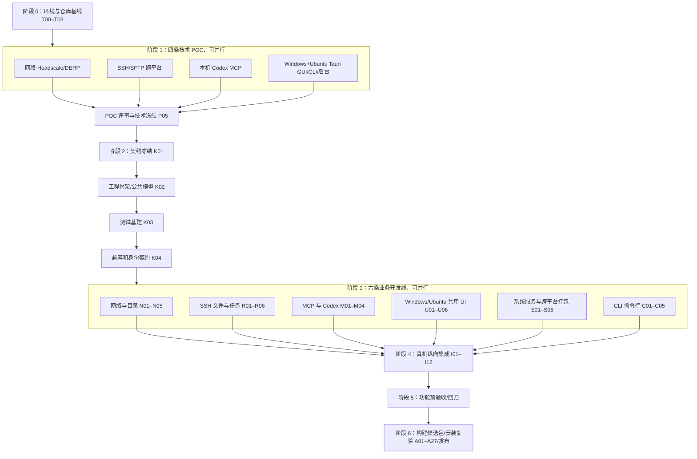

# 跃点 HopNode — Codex 施工实施计划（Plan.md）

> **产品名称**：跃点 HopNode  
> **品牌口号**：跨越边界，连接无限。  
> **文档版本**：V1.2  
> **创建日期**：2026-10-18  
> **文件作用**：将 PRD 的功能要求和 Design 的技术架构拆分为可由 Codex 逐步执行、部分并行、逐关验收的开发任务。  
> **依据文档**：`PRD.md`（产品需求 V1.4）、`Design.md`（技术设计 V1.3）、`AGENTS.md`（Codex 仓库约束 V1.0）  
> **创建者**：ChatGPT（计划初稿；源码作者及后续实际修改者以执行环境中的本地 `git config user.name` 为准）  
> **实施状态**：**执行中（2026-10-19）**。T00 已建立执行台账，工程初始化与隔离 POC 正在推进；逐任务实测及阻塞见 `docs/implementation/status.md`。未勾选项目不表示已实现、测试或发布。
> **仓库平台**：**GitHub**；CI/CD 使用 **GitHub Actions**；最终产物经 **GitHub Releases** 发布。**不使用 GitLab**。  
> **V1.2 修订说明**：增加双模式首次连接、受控停用/撤销、进程身份、升级/回滚、SSH/MCP 兼容、性能验收任务；新增 K04、N05、R06、M04、U06、S05–S06、C05、I09–I12、L07；交付验收扩展至 A01–A27，新增仓库级 AGENTS.md。

---

## 0. 给 Codex 的总执行指令（先读本节）

**目标**：按本计划交付可安装的 **Windows GUI + CLI + Service**、**Ubuntu Desktop GUI + CLI + systemd**、**Ubuntu Server CLI + systemd**，均可作为主控/受控/双角色、跨网络操作设备并由本机 Codex 通过 MCP 调用的 HopNode V1。不得将页面原型、模拟响应、空壳安装包或单机演示视为产品验收通过。

Codex 在仓库开始工作时应按以下规则执行：

1. 依次阅读 `PRD.md`（V1.4）、`Design.md`（V1.3）、`Plan.md`（V1.2）、`AGENTS.md`（V1.0）。以 **PRD 定义“做什么”**、**Design 定义“怎么做”**、**Plan 定义“以何顺序实施和验证”**。三者冲突时暂停相关任务，写 `docs/decisions/ADR-xxxx.md` 说明差异，不擅自删除 PRD 功能；可继续推进无冲突任务。
2. 先检查仓库、Git 状态、平台工具链及可用测试机器。**只修改尚未完成或需修复的任务**，不覆盖已有可用代码、配置、用户 SSH/Tailscale 网络或机密文件。
3. 执行任务前检查依赖是否通过；每个任务必须包含**真实代码或配置、自动测试、手工验证方法、证据、已知限制和状态更新**。执行完一项就更新第 10 节状态，不得成批虚构“已完成”。
4. **只允许同阶段、依赖已满足、文件写入区域不冲突的任务并行**。并行任务用不同分支或 Git worktree；各自提交 PR；由集成负责人合并。若仅有单个 Codex 会话，按本计划拓扑顺序串行完成即可，绝不为了“并行”在同一工作区竞争修改。
5. 先做网络、SSH、MCP、桌面 IPC 与系统服务 POC，通过后再冻结契约、扩展模块；**先完成真实端到端最小闭环，再全面铺开 UI**。没有物理设备或公网部署权限时，不伪称实机验收完成，明确登记 `BLOCKED` 和所缺资源。
6. GitHub 仓库和 Actions 是唯一代码协作与发布渠道。所有版本、依赖、Runner、打包配置应锁定经验证的版本；正式构建不使用不受控的 `latest`。
7. 用户偏好尽量少登录、少配置、灵活操作：不添加无需求的账户注册、层层审批、固定工作目录/命令白名单；**仍保留 SSH 认证、Host Key 校验、设备注册身份及操作系统本身的权限边界**。
8. 凡是运行日志、密钥、token、密码、真实设备 IP 等敏感信息，只放在本机受保护存储或测试环境 Secret，不提交 GitHub，不输出到 MCP 普通响应、截图或验收证据。
9. 若需要修改 PRD 或 Design 中已经冻结的接口、目录、交付范围，先提出 ADR 和迁移方案；不得因为某个功能复杂而默默删掉。**Ubuntu GUI 与 Ubuntu CLI 均为强制交付，不得降级为后续版本。**
10. **停止条件**：PRD F01–F18 与 **A01–A27** 均有实现及验收证据；Windows GUI、Windows CLI、Windows Service、Ubuntu GUI `.deb`、Ubuntu Core/CLI `.deb`、Ubuntu systemd 在规定系统实际安装验收；有发布说明及 SHA-256，才可标记 V1 已完成。

### 0.1 统一任务状态

- `TODO`：未开始；`READY`：依赖已满足、可启动；`IN_PROGRESS`：正在开发；`BLOCKED`：缺少环境、授权、契约或技术验证；`REVIEW`：代码完成，等待 CI/审查；`DONE`：验收通过，有证据；`REWORK`：需返工。
- 计划中的 `[ ]` 表示 **尚未完成**。只有满足该任务的“完成判据”才可更新为 `[x]`。
- 对外部依赖、实机联网、安装权限、用户确认的硬阻塞，单独登记，不通过硬编码假数据绕过。

### 0.2 文件头与 Git 提交规范

- 新增源代码文件头写“文件用途、创建者、创建日期”；作者由执行者本地 `git config user.name` 读取。重要修改写清修改原因，优先记录于 Git commit / PR；不得凭空填写某个人名。
- `.json`、`go.mod`、`Cargo.toml`、YAML 等不能随意插入无效注释的格式，作者和改动记录写入相邻说明文件或 Git 历史，不破坏语法。
- 提交应小而可测试，如 `feat(ssh): add host key verification`；PR 写明任务 ID、PRD 编号、自动检查、实机测试、风险和回退方式。

---

## 1. 交付边界与一致性约束

### 1.1 V1 必须交付

| 类别 | 必须达成的结果 |
| --- | --- |
| 软件形态 | **Windows 10/11 x64：Tauri GUI 安装包 + CLI + Windows Service；Ubuntu Desktop 22.04/24.04 x64：Tauri GUI `.deb` + CLI + systemd；Ubuntu Server 22.04/24.04 x64：CLI + systemd（不依赖图形库）** |
| 桌面 UI | **Windows 和 Ubuntu Desktop 共用** React + TypeScript + Vite + Ant Design 6、lucide-react、xterm.js、深色科技主题、设备/文件/终端/任务/MCP/设置页面 |
| CLI 工具 | **Windows、Ubuntu Desktop/Server 必交付 `hopnodectl`**；主控/受控/双角色管理、设备/SSH/文件/命令/任务/服务/诊断及 `--json`/退出码；复用 Go Core 和 IPC 契约 |
| 后台能力 | Go `hopnode-core`：`controller`、`agent`、`mcp`、`task-runner`；窗口关闭不影响已配置的独立后台服务 |
| 网络 | Tailscale + Headscale + DERP；同局域网、不同网络均可连；支持手动 SSH 设备；不自研穿透 |
| 设备目录 | Go `hopnode-directory`、稳定 `device_id`、心跳、角色状态、在线/SSH 状态分离；试点 SQLite，按需 MySQL |
| 操作 | SSH 密码/密钥认证、SFTP 文件操作及传输、终端 PTY、命令和后台任务、备份及诊断 |
| AI 接入 | 本地 Codex 自动检测、一键注册名为 `hopnode` 的 **MCP stdio** 服务，Codex 真正调用远端设备 |
| 交付与协作 | GitHub Monorepo、GitHub Actions CI/集成/发布流水线、GitHub Releases、部署与运维文档、验收记录 |

**首版明确不做**：远程图形桌面（控制另一台计算机的可视桌面）、移动端主控、macOS 客户端、通用云端 MCP、复杂多租户和审核流。**Ubuntu GUI 是本地安装的跃点管理界面，必须 V1 交付，与“远程图形桌面”是两个不同功能。**

### 1.2 三份依据文档的统一解释（Codex 不得各自实现两套）

1. **MCP 注册名固定为 `hopnode`**，PRD/Design/Plan/AGENTS 的新文档示例均已统一；CLI 为 `hopnodectl`，组织设备入网统一为 `enroll`（旧 `login` 只允许作为明确声明的兼容别名）。
2. **“免账号”指免跃点个人账号**，不代表没有 SSH 登录、设备注册和系统服务安装授权。
3. “关闭受控”只能保证**跃点所管理的会话和入口停止**，不得承诺关闭用户已有的独立 SSH、Tailscale 通道。
4. 普通 SSH 设备没有 HopNode agent 时，**不得声称支持可靠断线后长任务恢复**；需要 task-runner 或经实测支持的后台方案。
5. **本机 Codex MCP** 与网页/云端 Codex 不同。只实现本机 stdio 闭环，不把网页端“已连接”当验收标准。
6. GUI 不能直接调用系统任意命令；统一通过 Tauri 薄桥接访问受控的 Go controller IPC，MCP 复用相同业务核心。
7. Tauri Sidecar 用于打包可执行文件，**不替代独立的 Windows Service / systemd**。任何安装/退出/升级场景不得把 GUI 子进程误认为常驻服务。
8. Ubuntu Desktop GUI、Ubuntu Server CLI 和 Windows GUI/CLI 必须调用相同的 Go Core/IPC 契约；Ubuntu GUI 在 22.04 构建基线下生成 `.deb`，在 22.04/24.04 分别实机安装；CLI 无图形依赖。

---

## 2. 阶段依赖总图与并行策略

### 2.1 全局施工顺序



> Mermaid 图是**任务依赖**而非实际已经运行的调度器。阶段内存在细粒度依赖，详见下面各任务和第 9 节。并行是允许而非强制。

### 2.2 并行分组总表

| 并行组 | 开始条件 | 可同时执行 | 必须等什么再合并 | 不可并行修改 |
| --- | --- | --- | --- | --- |
| **P（风险 POC）** | T00–T03 完成，测试资源可用 | P01、P02、P03、P04 | P05 形成快速 SSH/组网、SSH/MCP、服务身份的真实测试结论 | 生产契约、正式公共 Go 模型 |
| **B（业务开发）** | P05、K01–K04 通过 | N、R、M、U、S、**C CLI** 六条线 | 逐模块 CI 通过、契约检查、I01–I12 集成 | `contracts/`、根 `go.mod`、`go.sum`、根 lockfile、`cmd/` 入口、共用 IPC 核心 |
| **V（验证与文档）** | 相应业务接口已合并 | 单测完善、UI 自动化、帮助文档、部署文档 | 真实跨端集成与验收完成 | 同一份发布清单和版本号 |
| **Release 构建** | G5 功能预验收完成 | Windows GUI/CLI 包、Ubuntu GUI `.deb`、Ubuntu Core/CLI `.deb`、校验摘要并行构建 | Release 负责人汇总签名/附件及实机复验 | 正式版本标签和 Release 元信息 |

**推荐执行方式**：一个主 Codex 负责契约、拆分、集成和验收；有多个 Codex 工作者时，在各自的 Git worktree 中处理 N/R/M/U/S/C。没有多代理能力时按照依赖串行实施，质量目标不变。

### 2.3 并行分支、目录所有权

| 角色 / 工作流 | 建议分支 | 主写入目录 | 所有权边界 |
| --- | --- | --- | --- |
| 总集成（负责人） | `main` / `feat/foundation-*` | `contracts/`、`cmd/`、根依赖、`.github/`、`Plan.md` | 冻结公共 API，仲裁冲突，集成后更新状态 |
| 网络组 N | `feat/network-directory` | `internal/overlay/`、`internal/enrollment/`、`internal/directory/`、`deployments/` | 目录/设备撤销与 Headscale/DERP，不接管 SSH 文件传输 |
| 远程组 R | `feat/ssh-files-tasks` | `internal/sshclient/`、`internal/sshconfig/`、`internal/sftpclient/`、`internal/tasks/`、`internal/backup/` | 不编辑 MCP Tool 列表或前端表格组件 |
| AI 接入组 M | `feat/mcp-codex` | `internal/mcpserver/`、`internal/codex/`、`contracts/mcp/`（仅提出改动） | 必须通过 controller 的公开接口；不能自建另一套 SSH 核心 |
| 桌面 UI 组 U | `feat/desktop-ui` | `apps/desktop/src/` | Windows/Ubuntu 同一 UI，双平台验收；不复制 Go 业务 |
| CLI 组 C | `feat/cross-platform-cli` | `cmd/hopnodectl/`、`internal/cli/` | 只通过约定的 controller/IPC 接口；CLI 无 GUI/WebKitGTK 依赖，根依赖变更由负责人合并 |
| 平台组 S | `feat/service-runtime` | `internal/runtime/`、`internal/lifecycle/`、`internal/agent/`、`internal/ipc/`、`internal/store/`、`internal/secrets/`、`apps/desktop/src-tauri/`、`packaging/` | 修改 IPC Schema 先提变更申请；受控 agent 不使用主控用户的 SSH 私钥 |

**资源冲突处理**：任何两个 PR 都要修改根 `go.mod`、`pnpm-lock.yaml`、`contracts/` 或 Go `cmd/` 时，先由负责人合并基础 PR；其他分支 rebase 后继续。不得靠覆盖冲突文件“解决”冲突。

---

## 3. 阶段 0：工程初始化（严格串行）

### [x] T00 — 读取依据与生成执行台账

- **输入**：PRD V1.4、Design V1.3、Plan V1.2、AGENTS V1.0、现有仓库（若已存在）。
- **动作**：确认版本一致；枚举 F01–F18、A01–A27；检查当前文件和 Git 状态，记录平台、工具版本及网络/安装权限。
- **产物**：`docs/implementation/status.md`、`docs/implementation/risks.md`、`docs/implementation/test-environment.md`（仅保存脱敏测试环境信息）；缺少的资源标 `BLOCKED`。
- **完成判据**：所有 18 项功能和 27 项验收编号进入台账，任何未知环境变量明确标注“尚未验证”。
- **依赖**：无。**执行人**：总集成。

### [x] T01 — GitHub Monorepo 结构及本地开发环境

- **动作**：依据 Design 第 4 节建立并同步 `AGENTS.md`，新建 `docs/compatibility.md`，建立 `apps/desktop/`、`cmd/`、`internal/`、`contracts/`、`deployments/`、`packaging/`、`scripts/`、`tests/`、`docs/`；配置 pnpm workspace、Go module、Tauri 工程、`.editorconfig`、`.gitignore`、LICENSE 待决说明。
- **要求**：不初始化第二个嵌套仓库；不提交密钥、`node_modules`、`target`、`dist`、真实设备数据；依赖以锁文件固定。
- **产物**：最小可启动 UI、最小 `hopnode-core --version` 和 `hopnode-directory --version`，以及 README 的开发环境指引。
- **完成判据**：本机可执行前端开发服务、Go 构建、Rust 检查；基础命令可由 README 复现。
- **依赖**：T00。**执行人**：总集成。

### [x] T02 — GitHub 协作与基础 CI

- **动作**：建立 `.github/workflows/ci.yml`、`integration.yml`、`release.yml` 的可验证初始版本；配置 GitHub Issue/PR 模板、分支保护建议和版本策略。
- **规则**：普通 PR 跑静态检查、单测及跨平台编译烟测；网络实机测试仅在受保护、隔离环境手动触发；Release 不在普通 PR 上进行。
- **完成判据**：PR 触发真实 CI，未通过检查的 PR 不被标为“已验收”；Release 仅测试可运行性，**不得提前发布产品版**。
- **依赖**：T01。**执行人**：总集成。

### [ ] T03 — 测试环境准备与凭据隔离

- **动作**：准备 Windows 10/11 x64 GUI+CLI 主控 A、Windows 10/11 受控 B、**Ubuntu Desktop 22.04/24.04 GUI+CLI 测试机 C（两版本分别测试）**、**Ubuntu Server 22.04/24.04 CLI+systemd 测试机 D（两版本分别测试）**；至少两机位于不同网络；准备 Headscale/DERP 隔离环境和 SSH 测试账户。
- **判据**：记录 OS、网络条件、是否具有管理员/sudo、SSH 配置、Codex 可用性、可否部署公网 HTTPS；密钥保存在机器密钥库/Secrets。
- **无环境时**：保留可执行 mock/unit test，不把 POC 或 A03/A04/A14 标 `DONE`，继续推进不依赖设备的任务。
- **依赖**：T01。**执行人**：总集成/环境管理者。

**阶段 0 出口门槛 G0**：代码仓库结构与 CI 跑通，依赖锁定方式确定，测试环境及缺口清晰；否则不得标记阶段完成。

---

## 4. 阶段 1：高风险 POC（P01–P04 可以并行）

### [ ] P01 — Tailscale / Headscale / DERP 跨网络 POC

- **依赖**：T03；**并行**：可与 P02/P03/P04 同时。
- **实现/验证**：试点 Headscale 服务和 DERP；设备非交互入网、节点间连通；读取直连/中继/未知状态；模拟阻断 P2P 观察 DERP 回退；识别已有 Tailscale 网络时不静默覆盖。
- **产物**：`tests/pocs/network/` 复现步骤、`docs/decisions/ADR-network.md`、部署配置示例（不含真实密钥）。
- **验收**：A、B 不同网络下能访问测试 SSH 服务；阻断直连后仍通过 DERP 操作；有日志/截图证明链路状态而非主观推测。

### [ ] P02 — Windows / Linux SSH、SFTP 及任务语义 POC

- **依赖**：T03；**并行**：P01/P03/P04。
- **实现/验证**：Go SSH 快速连接（无需 Headscale/Directory/Agent）、密码/私钥、Host Key 校验、基本 SSH config 的 Host/HostName/User/Port/IdentityFile，并评估 ProxyJump/ssh-agent；Windows OpenSSH 与 Ubuntu sshd 分别执行 `whoami`、路径列举、临时文件读写、10 MB 传输、PTY；调查 Windows/Linux 后台任务断线时的真实行为。
- **产物**：`tests/pocs/ssh/` 最小工具和证据、`docs/decisions/ADR-ssh-task.md`。
- **验收**：至少 Windows 与 Linux 两种受控系统完成真实命令、文件和传输；无法稳定持久化的任务能力明确降级，不夸大。

### [ ] P03 — 本地 Codex + Go MCP stdio POC

- **依赖**：T03；**并行**：P01/P02/P04。
- **实现/验证**：以官方 Go MCP SDK 固定版本创建独立 stdio 测试工具，确保 stdout 仅输出协议消息；验证本机 Codex 注册、加载、协商协议版本、真实工具调用、错误返回与取消。
- **产物**：`tests/pocs/mcp/`、`docs/decisions/ADR-codex-mcp.md`，记录测试客户端类型和版本。
- **验收**：Codex 能运行并调用 POC Tool，非仅看到配置文本；不得以网页端代替本机 MCP 实测。

### [ ] P04 — Windows/Ubuntu Tauri 2 GUI + Go IPC + CLI + 系统服务 POC

- **依赖**：T03；**并行**：P01/P02/P03。
- **实现/验证**：**Windows GUI（Named Pipe）与 Ubuntu Desktop GUI（Unix Socket）均真实调用 Go controller**，验证 Ubuntu 22.04/24.04 WebKitGTK 4.1、Tauri `.deb` 构建安装与 GNOME/Wayland/X11；最小托盘、关闭窗口后服务常驻；Windows Service 和 Ubuntu systemd；`hopnodectl` 在无 DISPLAY 的 Ubuntu Server 运行；评估 Sidecar 与独立 Core/CLI 两包的安装职责；从 Ubuntu 桌面菜单启动测试 Codex 路径发现和手工选取，测试注销后 controller/agent 身份与运行状态。
- **产物**：`tests/pocs/desktop-service/`、`docs/decisions/ADR-desktop-runtime.md`。
- **验收**：**Windows 与 Ubuntu GUI 均可在实际桌面系统安装启动并访问真实 IPC**；Ubuntu 22.04/24.04 GUI 运行日志、依赖报告归档；Ubuntu Server 无 GUI 的 `hopnodectl status/doctor` 可执行；两系统的 GUI 关闭后服务仍运行、systemd/Windows Service 启停可观察。

### [ ] P05 — POC 联合评审与冻结决策（严格依赖四项结论）

- **依赖**：P01–P04 有**明确结果**（通过或标明阻塞/失败及回退），不是要求全部技术风险都人为“通过”。
- **动作**：确认 Tauri 2 在 Windows 与 Ubuntu Desktop 两边均适用，Go CLI 在 Ubuntu Server 无图形依赖；锁定版本与测试矩阵；分别确定快速 SSH/托管组网首次使用流程，确认 SSH 配置兼容界限、受控凭据撤销策略、用户态与系统态服务身份、MCP stdio 协议和 IPC。为 A25 记录性能测试环境并提出数值阈值草案（阈值需负责人在 K04 冻结）。
- **决策**：遇到 POC 技术失败先形成 ADR（修复、降级或替代），不得直接以假实现推进对应功能；例如需要改 Wails v2 时必须同步 Design、依赖和目录。
- **产物**：`docs/decisions/ADR-0001-v1-stack.md`、`packaging/manifests/versions.md`、风险清单更新。
- **出口门槛 G1**：真实 POC 结论已存档，阻断后续开发的未决风险已关闭或有明确授权的替代路线。

---

## 5. 阶段 2：冻结契约与集成骨架（严格串行）

### [ ] K01 — 统一接口契约和错误语义

- **依赖**：P05。
- **修改权限**：只有总集成负责人能直接改公共契约。并行开发人员通过 PR 提交兼容修改建议。
- **产物**：`contracts/ipc/core-api.schema.json`、`contracts/ipc/errors.schema.json`、`contracts/directory/openapi.yaml`、`contracts/mcp/tools.schema.json`、`docs/api.md`。
- **必须包含**：稳定 `device_id`、`operation_id`、`task_id`、版本字段、统一错误码、连接状态和任务状态、设备/文件分页、取消与未知结果语义；本机 IPC 方法和事件名称；MCP Tool 参数/结果结构。
- **完成判据**：契约可被 schema 验证器读取，含正常与错误样例；Go 和 TypeScript 可共享或生成类型，不再靠口头约定字段。

### [ ] K02 — 公共 Go 核心、桌面 IPC 桥与可替换适配器

- **依赖**：K01。
- **动作**：稳定 `hopnode-core controller|agent|mcp|task-runner` 后台入口、独立 `hopnodectl` CLI 入口；定义 interface 和依赖注入点；实现 Go controller 的启动、停止、`health`、版本、事件订阅、稳定错误模型以及 Tauri 薄桥接。
- **策略**：允许实现可控 FakeAdapter 用于 UI 单元测试，但**只存在于测试或显式开发模式**，生产模式不存在静默回落 Mock 的机制。
- **完成判据**：Windows GUI、Ubuntu GUI、`hopnodectl`、MCP POC 使用公共核心接口获取相同版本/状态；生成的类型匹配契约。

### [ ] K03 — 测试夹具、契约测试与 CI 门禁

- **依赖**：K02。
- **动作**：添加隔离的本地 SSH 测试夹具、临时目录、测试设备数据、示例假认证信息、Go/TS 类型校验；完善 Windows/Ubuntu GUI/CLI CI；定义需要真机的测试如何跳过并明确报告 `NOT_RUN`。
- **产物**：`tests/fixtures/`、`tests/integration/` 基架、`scripts/integration-test.sh`、`scripts/integration-test.ps1`（如适用）。
- **完成判据**：无真机时仍可运行全部单元/契约检查且诚实区分集成测试未运行；PR 合并前 CI 可靠阻断破坏契约的代码。

### [ ] K04 — 兼容版本、身份及首启模式契约冻结

- **依赖**：K03；**负责**：总集成。
- **动作**：冻结 `contracts/version-policy.md`、`GetCapabilities`/IPC API 版本、设备 `source` 与撤销状态、`hopnodectl enroll` 命令、`hopnode` MCP 注册名；形成 Windows/Ubuntu 用户态/系统态进程身份矩阵及 SSH config 支持表的验证计划；审核批准性能阈值草案并存放 `docs/implementation/performance-baseline.md`，无法冻结时 A25 标 BLOCKED。
- **完成判据**：N/R/M/U/S/C 六组签收同一接口与兼容约定，契约测试可运行；AGENTS.md 限制和版本关联到 CI。

**阶段 2 出口门槛 G2**：K01–K04 均已通过且提交；所有并行组拿到同一份契约、版本策略和可构建仓库；任务所有权明确。

---

## 6. 阶段 3：业务模块六线并行

> **并行规则**：以下 N/R/M/U/S/C 各线可以同时进行；**同一条线内部默认顺序执行**。完成一个可独立测试的子任务就提交 PR，而非等到整个子系统完成才一次性合并。跨线对接以 K01 契约为准。

### 6.1 N 线 — 跨网络与设备目录

| 任务 | 依赖 | 具体施工 | 产物路径 | 完成判据 |
| --- | --- | --- | --- | --- |
| [ ] **N01 网络适配** | K03，P01 | 检测 Tailscale、读取节点/链路状态、连接/重连、复用现有网络的诊断 | `internal/overlay/` | 状态区分直连/中继/未知，断线可诊断，不静默退出已有网络 |
| [ ] **N02 注册与入网** | N01 | Headscale 非交互入网、一次性设备注册、凭据过期与销毁 | `internal/enrollment/`、`deployments/headscale/` | 新设备可注册；失效凭据拒绝；安装包无长期管理密钥 |
| [ ] **N03 目录服务** | K03，可与 N01 开发但合并须 N02 对齐 | Go Directory API、设备持久化、角色、10s 心跳、30s 待确认、60s 离线、查询和修改备注 | `internal/directory/`、`deployments/directory/` | 稳定 ID、离线状态、认证和 API 契约测试通过 |
| [ ] **N04 设备发现与手动 SSH** | N02、N03 | 把已受控设备与手动 SSH 记录合并成可区分来源的列表；搜索/过滤 | `internal/controller/` 中由负责人集成、N 线提交接口适配 PR | IP 变化不生成重复；无 agent 设备不冒充在线心跳 |
| [ ] **N05 设备撤销与重装** | N02–N04；S02 的受控状态接口由 N/S 双方按 K04 契约对接（模块可先并行） | 设备状态 active/suspended/revoked/retired、节点凭据撤销、失效 token 拒绝重用、重装重新绑定，保留审计 | `internal/enrollment/`、`internal/directory/` | 已撤销设备不能凭旧 token 重新注册或发起新的托管访问，A26 真机可复测 |


### 6.2 R 线 — SSH、SFTP、终端、任务

| 任务 | 依赖 | 具体施工 | 产物路径 | 完成判据 |
| --- | --- | --- | --- | --- |
| [ ] **R01 SSH 身份与会话** | K03，P02 | 密码/私钥/SSH config、Host Key 校验、超时、取消、设备会话管理 | `internal/sshclient/` | Windows/Linux 真实 `whoami`，未知/变化 Host Key 行为正确 |
| [ ] **R02 文件浏览与编辑** | R01 | 列举、搜索、文本读取、写入/补丁、mkdir、移动/复制/重命名/删除、Windows/Linux 路径适配 | `internal/sftpclient/` | 文本/二进制/中文/空格路径/权限错误；不假设 SFTP 支持不存在的服务端操作 |
| [ ] **R03 上传下载** | R02 | 文件与目录分块传输、进度、取消、失败重试、支持时续传 | `internal/sftpclient/` | 10 MB 文件校验一致，断线行为准确；未证实续传则标明不可用 |
| [ ] **R04 PTY 与命令执行** | R01 | 交互式终端、shell/cwd/env/timeout、窗口 resize、stdout/stderr/exit code | `internal/sshclient/`、`internal/tasks/` | 终端会话保持、Windows/Linux shell 正确、错误码可定位 |
| [ ] **R05 长任务与备份恢复** | R02、R04，S02 提供 agent/task-runner 接入后完成整体验收 | task ID、状态查询/取消、断线后结果查询、默认备份/恢复、操作记录、不可确定结果不重试 | `internal/tasks/`、`internal/backup/` | managed 设备断线后能查询，manual SSH 如实降级；覆盖后有可恢复证据 |
| [ ] **R06 SSH 配置兼容矩阵** | R01、P02 | 校验 Host/HostName/User/Port/IdentityFile、Host Key；实测 Include/Match、ProxyJump、ssh-agent 的支持或明确降级，更新兼容文档 | `internal/sshconfig/`、`docs/compatibility.md` | Windows/Ubuntu 对比 `ssh -G` 与实际连接，失败能力不虚报，A24 可复测 |


### 6.3 M 线 — MCP 与 Codex

| 任务 | 依赖 | 具体施工 | 产物路径 | 完成判据 |
| --- | --- | --- | --- | --- |
| [ ] **M01 MCP stdio 服务** | K03，P03 | 使用 Go MCP SDK 封装设备/文件/命令/终端/任务接口，所有写操作包含 deviceId | `internal/mcpserver/` | 标准客户端可发现 Tools，stdout 不混入日志，错误返回结构化 |
| [ ] **M02 Codex 检测与一键接入** | M01 | 检测安装实例及版本、识别有效配置位置、备份或增量写入 `hopnode` MCP、提供复制配置、验真工具调用 | `internal/codex/` | 不覆盖其他 MCP；配置后 `list_devices` 真可调用；不能把“写入配置”当完成 |
| [ ] **M03 全 Tool 覆盖与多设备防误操作** | M01，R01–R05 的相关接口合并后逐步扩展 | 完整 MCP 工具表、参数/返回验证、deviceId 明确绑定、超时与 taskId；复制给 Codex 文本 | `internal/mcpserver/` | Design §9.3 中全部 Tool 有测试；操作两台设备不会串设备 |
| [ ] **M04 MCP 版本协商与 Codex 兼容** | M01–M03、P03 | 锁定官方 Go MCP SDK 版本/协议协商，Ubuntu 桌面启动 Codex 查找与手动定位，测试错误/取消/旧客户端 | `internal/codex/`、`internal/mcpserver/`、`docs/compatibility.md` | stdio 实测版本矩阵与工具回归，A24/A27 可复测 |


### 6.4 U 线 — 桌面 UI

| 任务 | 依赖 | 具体施工 | 产物路径 | 完成判据 |
| --- | --- | --- | --- | --- |
| [ ] **U01 视觉基础与导航** | K03，P04 | Windows/Ubuntu 共用 Ant Design 6 Token、深/浅色、lucide、布局/路由、状态标识/加载/空态 | `apps/desktop/src/app/`、`layouts/`、`styles/` | Windows GUI 与 Ubuntu GUI 均可运行、布局真实响应，非静态截图 |
| [ ] **U02 引导、设备与设置** | U01 | Onboarding、Dashboard、Devices、DeviceDetail、Settings，连状态/搜索/角色/SSH 配置 | `pages/`、`features/devices/`、`features/settings/` | 真实 controller 接入；模拟数据仅测试开关中使用 |
| [ ] **U03 文件与终端** | U01，R02、R04 提供稳定接口后可分页面并行 | SFTP 文件树、上传下载进度、diff、终端 xterm.js 和 resize | `features/files/`、`features/terminal/` | Windows/Linux 实机文件读写与终端，正常展示错误/进度 |
| [ ] **U04 MCP 与任务可观测** | U01，M02、R05 接口可用 | MCP 接入步骤、复制给 Codex、任务中心/日志/诊断 | `features/mcp/`、`features/tasks/`、`components/feedback/` | “已接入”需要真实健康检查；结果未知可见，诊断报告不泄露密钥 |
| [ ] **U05 Ubuntu GUI 适配与一致性** | U01–U04、P04 | Ubuntu GNOME 桌面入口、Wayland/X11、托盘、文件对话框、快捷键、中文路径与 xterm.js；与 Windows GUI 对照走查 | `apps/desktop/src/`、`tests/e2e/ubuntu-gui/` | Ubuntu 22.04/24.04 上全部核心页面可真实调用 Core，主控/受控/双角色与 Windows 功能等价 |
| [ ] **U06 双模式首启向导** | U02、N04、R01 | 快速 SSH 无需企业服务即可添加目标、首次确认 Host Key、测试命令；托管组网引导导入配置/设备注册、清楚展示授权限制 | `apps/desktop/src/pages/OnboardingPage.tsx`、`features/connections/` | Windows/Ubuntu GUI 无 Headscale 也可完成快速 SSH 闭环，A20 可复测 |


### 6.5 S 线 — 本地服务、存储和打包基建

| 任务 | 依赖 | 具体施工 | 产物路径 | 完成判据 |
| --- | --- | --- | --- | --- |
| [ ] **S01 本地 IPC/SQLite/Secrets** | K03，P04 | Named Pipe/Unix Socket、协议版本、缓存及数据库迁移、OS 受保护凭据、结构化日志 | `internal/ipc/`、`internal/store/`、`internal/secrets/` | 普通网络不能访问本机管理 IPC；凭据不落日志和前端缓存 |
| [ ] **S02 Agent 与后台任务运行时** | S01，P02 | Windows Service、Linux systemd、角色开关、agent 心跳、task-runner 权限/状态、开机运行 | `internal/agent/`、`internal/runtime/`、`deployments/systemd/` | 关闭 UI、服务重启后行为清晰；停止受控终止 HopNode 会话，不声称关闭独立系统 SSH |
| [ ] **S03 桌面原生桥与安装、卸载原型** | S01，U01 可同步沟通 | Windows/Ubuntu Tauri invoke/事件、托盘、Core 版本探测、服务管理入口、各平台构建配置 | `apps/desktop/src-tauri/`、`packaging/` | Windows/Ubuntu GUI 都能查询真实 controller；独立服务与 GUI 生命周期分离 |
| [ ] **S04 Ubuntu GUI/CLI 分包和安装规则** | S02、S03，U05 可分开推进 | Linux `.deb`：GUI 包含桌面入口/WebKitGTK 依赖，Core/CLI 包含 systemd、`hopnodectl`；包间版本依赖、安装升级/卸载脚本、可选 AppImage 检测依赖 | `packaging/linux/`、`apps/desktop/src-tauri/` | 两个 Ubuntu 包均可安装、卸载且角色/IPC/凭据位置正确，不破坏既有 SSH/Tailscale；Server 不安装 GUI 依赖 |
| [ ] **S05 进程身份与停止受控** | S01–S03、N05 | 固定 GUI/controller/agent 在注销、重启、故障时的身份；完成托管入口禁用、跃点专用密钥撤销和可归属会话清理；记录独立 SSH 限制 | `internal/lifecycle/`、`internal/runtime/`、`docs/security-boundary.md` | Windows/Ubuntu 用户注销、System Service 及停用后真实连接结果，A21/A22 |
| [ ] **S06 GUI/Core/CLI 版本兼容与升级回滚** | S01、S03–S04、K04 | IPC 能力协商、数据库 migration 备份、安装包依赖、更新失败恢复、卸载不破坏现有 SSH/Tailscale | `contracts/version-policy.md`、`packaging/`、`internal/store/` | 用开发构建包完成兼容/迁移/恢复预验证；候选版升级实测在 L06 进行，A23 最终以 L06 结果为准 |


### 6.6 C 线 — Windows/Ubuntu CLI 独立程序

| 任务 | 依赖 | 具体施工 | 产物路径 | 完成判据 |
| --- | --- | --- | --- | --- |
| [ ] **C01 CLI 基础与 JSON/退出码** | K03，P04 | `hopnodectl --help/version/status/doctor`，Unix Socket/Named Pipe 同一契约，标准输出/错误与非零退出码 | `cmd/hopnodectl/`、`internal/cli/` | Windows/Ubuntu Desktop/Ubuntu Server 均可在终端运行；无 DISPLAY、WebKitGTK 也成功 |
| [ ] **C02 CLI 设备/角色/服务** | C01、N04、S02 | `devices list/show/add-ssh`、`role get/set`、`service status/start/stop`、网络入网/连接诊断 | `internal/cli/` | Ubuntu Server CLI 能真实完成主控/受控/双角色配置、发现和连接，不要求 GUI |
| [ ] **C03 CLI 文件/命令/任务** | C01、R02–R05 | `files list/get/put`、`exec`、`tasks list/show/cancel`、日志与批量调用 JSON/错误处理 | `internal/cli/` | Windows/Ubuntu 同一设备操作返回一致状态/校验结果，不复制第二套 SSH 逻辑 |
| [ ] **C04 CLI Codex 配置和发布验证** | C01、M02；正式打包由阶段 6 的发布任务接续 | `mcp doctor/install`，手册、Shell 自动补全（可选）、独立构建 Windows exe/Ubuntu ELF，包中可检索 `hopnodectl` | `internal/cli/`、`scripts/build-cli.*` | Ubuntu Desktop/Server 可独立检测本机 Codex MCP；独立 CLI 产物和安装约束已固定，Core/CLI `.deb` 中的 CLI 随 L03 验收 |
| [ ] **C05 CLI 快速连接、托管入网与撤销状态** | C02、R06；撤销子命令待 N05 接口就绪 | `devices add-ssh`、`enroll`、`devices revoke/status` 的帮助、JSON/退出码和能力限制；与 GUI 共享 Core | `internal/cli/`、`docs/cli.md` | 无 GUI 可用快速 SSH，不要求企业服务；托管撤销结果/错误码可复测 A20/A26 |


**阶段 3 出口门槛 G3**：六线核心实现已在独立 PR 测试通过，根公共模型不分叉；CI 显示明确的通过项及“待真机”项。不可因前端页面完成而跳过后端/系统服务。

---

## 7. 阶段 4：纵向端到端集成（主链串行，Ubuntu 双线可并行）

| 任务 | 强制依赖 | 真正需要跑通的流程 | 完成判据与证据 |
| --- | --- | --- | --- |
| [ ] **I01 手动 SSH 最小闭环** | R01/R02/R04、S01、U02/U03 基础接口 | Windows GUI → controller IPC → 指定 IP/域名 SSH → `whoami` / 文件读写 → UI 展示 | `tests/e2e/manual-ssh/`：Windows 与 Ubuntu 各至少一次成功和失败测试 |
| [ ] **I02 本机 Codex MCP 真实闭环** | I01、M01/M02 | 本地 Codex → `hopnode` MCP stdio → controller → SSH/SFTP → 修改测试文件 → 返回结果 | `tests/e2e/codex-mcp/`：真实 Tool 调用记录及远端文件校验；不以 mock 代替 |
| [ ] **I03 自动设备发现闭环** | N01–N05、S02、I01 | 受控安装 agent → Headscale 入网 → directory 心跳 → 主控列表发现稳定 ID → 一键选择操作 | `tests/e2e/discovery/`：角色、在线、SSH 状态分离，IP 改变不重复记录 |
| [ ] **I04 真实跨网络 + DERP** | I02、I03、P01 | A 家庭网络，B 公司/另一网络，经设备目录发现并由 MCP 文件修改；阻断直连验证中继 | `tests/e2e/cross-network/`：链路与结果证据；不可只测同一 LAN |
| [ ] **I05 文件、终端、任务、备份一体化** | I04、R03/R05、U03/U04、S02 | 上传/下载、PTY、长任务取消及断线查询、覆盖前备份/恢复、操作日志 | `tests/e2e/operations/`：成功/失败/结果未知均有证据 |
| [ ] **I06 双角色、关闭受控及故障恢复** | I05、S03 | A/B 双角色、托盘关闭与自启、网络失连、SSH 失败、Host Key 变化、停止/重启服务 | `tests/e2e/lifecycle/`：不依赖 GUI 常开；停止受控实际拒绝新的 HopNode 操作 |
| [ ] **I07 Ubuntu Desktop GUI 真实闭环** | I03、U05、S04；可与 I05/I06 的部分开发平行 | Ubuntu 22.04/24.04：GUI 安装、登录桌面、主控/受控/双角色、设备/文件/终端/任务/MCP、关闭窗口后服务继续、卸载 | `tests/e2e/ubuntu-gui/`：**22.04 和 24.04 各一份实机测试报告**，不能用 Windows 截图代替 |
| [ ] **I08 Ubuntu Server CLI 无 GUI 闭环** | I03、C01–C05、S04；可与 I07 并行 | 无 DISPLAY 的 Ubuntu Server 22.04/24.04 安装 CLI+Core/agent，通过 CLI 入网、配置角色、列设备、SSH 命令/文件、查看任务并使用 systemd | `tests/e2e/ubuntu-cli/`：两个 Ubuntu 版本的 shell 记录/返回码，确认无图形依赖 |
| [ ] **I09 快速 SSH 两平台真实首次使用** | I01、U06、C05 | 无 Headscale/Directory/Agent，Windows/Ubuntu GUI/CLI → Host Key 确认 → SSH 命令/文件 | Windows/Ubuntu 四路径记录与错误处理，A20 |
| [ ] **I10 受控撤销与进程注销** | I06、S05、N05 | 托管停用/撤销后尝试新操作、检查专用凭据、注销与重启服务，同时验证独立系统 SSH 仍可正常运作 | Windows/Ubuntu agent 与目录真实证据，A21/A22/A26 |
| [ ] **I11 升级恢复与版本兼容** | I07、I08、S06 | GUI/CLI/Core 不同版本协商、开发构建包升级预验、模拟失败后恢复程序/SQLite；正式候选包升级及卸载验证留给 L06 | 开发构建旧版→新版及异常恢复报告；A23 的候选包部分留到 L06 |
| [ ] **I12 规模与 MCP/SSH 兼容验收** | N03、R06、M04、I04 | 100 逻辑设备、10 目标并发、1 GB 文件、DERP 运行，冻结 POC 阈值并实测；协商协议与 SSH config | 脱敏性能表/兼容矩阵（模拟与真实分列），A24/A25/A27 |


**集成缺陷规则**：修复落在责任模块并补回归测试；不在 UI 中伪造连接成功、不把全部异常改成一个“网络错误”。对未知写操作优先查询操作状态，绝不直接盲目重放。

---

## 8. 阶段 5：PRD 验收矩阵（每项均需证据）

**执行时序：**A01–A14 可随 I01–I06 做功能预验收，A20–A22/A26 可随 I09/I10 实测；A24/A25/A27 随 I12 实测。A15–A19、A23 的正式版本验收须在 L01–L05 候选包就绪后、L06 中完成。**需要候选安装包的验收项目不能反过来成为构建候选包的前置条件。**

### 8.1 F01–F18：功能到任务映射

| PRD 功能 | 主任务 | 需要展示的真实结果 |
| --- | --- | --- |
| F01 安装/主控受控选择 | S02、S03、U02、I06 | 两种角色及双角色可切换 |
| F02 环境准备 | S02、U02、U06、I03、I09 | Tailscale/SSHD/服务检测及修复入口 |
| F03 跨网络入网 | P01、N01、N02、I04 | 跨网直连/DERP 回退、重连 |
| F04 设备目录 | N03、N04、N05、U02、I03、I10 | 稳定 ID、筛选、在线/离线/待确认 |
| F05 手动添加 | N04、U06、C05、I01、I09 | 无 agent 的可达 SSH 设备可操作 |
| F06 Codex 检测 | P03、M02、M04、U04、I12 | 检测位置/版本，可手动指定 |
| F07 MCP 接入 | M01–M04、I02 | 一键注册、真实 Tool 健康检查 |
| F08 SSH 身份 | R01、R06、S01、I01、I12 | 密码、密钥、现有 SSH 配置受支持 |
| F09 文件操作 | R02、U03、I05 | 创建/改/删/移动/复制/搜索及目录 |
| F10 文件传输 | R03、U03、I05 | 上传下载、进度、失败反馈 |
| F11 命令执行 | R04、M03、I02 | shell/cwd/env/timeout/返回码 |
| F12 交互终端 | R04、U03、I05 | 真正交互及会话切换 |
| F13 长任务 | R05、S02、I05 | ID/查询/取消/断线后状态 |
| F14 多设备操作 | M03、U02、I06 | 设备 ID 明确、互不串操作 |
| F15 操作记录 | S01、R05、U04、I05 | 时间、目标、摘要、结果可追踪 |
| F16 后台运行 | P04、S02、S03、S05、I06、I10 | 托盘/自启/无人值守，不依赖窗口 |
| F17 停止受控 | N05、S05、U02、I06、I10 | 停止托管会话、拒绝新请求、重开可恢复 |
| F18 状态诊断 | S01、U04、I06 | 离线/认证/权限/MCP 未连可区分 |

**新增验收映射**：A20 → U06/C05/I09；A21 → S05/I10；A22 → S05/I10；A23 → S06/I11/L06；A24 → R06/M04/I12；A25 → I12；A26 → N05/C05/I10；A27 → M04/I12。


### 8.2 A01–A27：最终验收清单

> **每一行必须附**：实测环境、执行步骤、结果、截图或结构化日志、Git commit、验收人/日期。只有“有证据且结果符合 PRD”才可勾选。

| 勾选 | 验收 | 验证步骤 / 判据 | 对应集成任务 |
| --- | --- | --- | --- |
| [ ] | **A01 无账号使用** | 带公司配置安装后无个人注册登录；仍可识别设备身份 | I03、I06 |
| [ ] | **A02 两机操作** | 只有 A 安装 Codex，B 无 Codex 仍可远程读/改/执行 | I02、I03 |
| [ ] | **A03 跨网络** | A/B 在不同网络，文件读写和命令成功 | I04 |
| [ ] | **A04 中继回退** | 测试阻断直连，保留 DERP，显示中继并传文件 | I04 |
| [ ] | **A05 目录同步** | B 就绪后正常网络下 15 秒内显示；离线按阈值更新 | I03 |
| [ ] | **A06 Codex 接入** | 检测/手动定位，增量注册 MCP，重载后调用 `list_devices` | I02 |
| [ ] | **A07 复制操作** | 复制设备说明，实际调用匹配 `device_id` | I02、I06 |
| [ ] | **A08 文件管理** | Windows/Linux 各完成读、写、移动、上传、下载、删及备份恢复 | I05 |
| [ ] | **A09 灵活操作** | 任意 SSH 账号允许的工作目录与命令，不额外逐条审批 | I05 |
| [ ] | **A10 长任务** | 超时任务获取 ID，断线重连查状态/输出/退出码，不重复启动 | I05 |
| [ ] | **A11 双向角色** | 两机同时开主控/受控，并互相发起操作 | I06 |
| [ ] | **A12 停止与重启** | 关闭受控拒绝新的 HopNode 请求；重启服务恢复 | I06 |
| [ ] | **A13 故障解释** | 离线、认证失败、权限不足、MCP 未连分别报错 | I06 |
| [ ] | **A14 系统兼容** | Windows/Ubuntu 主控分别操作 Windows 和 Ubuntu 受控 | I01–I12 |
| [ ] | **A15 Ubuntu GUI** | Ubuntu Desktop 22.04/24.04 实装 `.deb`，双角色、设备、文件、终端、MCP 等页面成功 | I07 |
| [ ] | **A16 Ubuntu CLI 与 Server** | Ubuntu Server 两个版本无 GUI 安装 Core/CLI，systemd 开机运行、角色/设备/任务/命令操作成功 | I08 |
| [ ] | **A17 GUI/CLI 一致性** | Windows GUI/CLI、Ubuntu GUI/CLI 对同设备真实文件/命令执行一致，CLI JSON 与失败退出码可用 | I07、I08 |
| [ ] | **A18 Ubuntu 主控/MCP** | Ubuntu Desktop GUI 主控与 Ubuntu Server CLI 主控操作 Windows/Ubuntu；Ubuntu 本机 Codex stdio 真调用 | I02、I07、I08 |
| [ ] | **A19 安装/升级/卸载** | **Release Candidate** 含 Windows GUI、Ubuntu GUI、Ubuntu Core/CLI、摘要；Ubuntu Desktop/Server 实装、升级、卸载无破坏，合格后经 L06 复验、L07 正式 Release | I07、I08、L01–L05 |
| [ ] | **A20 快速 SSH** | 无 Headscale/Directory/Agent，在 Windows/Ubuntu GUI/CLI 手动连 SSH，真执行命令和文件 | I09 |
| [ ] | **A21 托管停用撤销** | 新 HopNode 请求拒绝；专用凭据已撤销，可归属会话处理有日志，不动用户独立 SSH | I10 |
| [ ] | **A22 后台身份生命周期** | GUI 关闭、用户注销、系统重启、服务崩溃与恢复按实际进程身份工作 | I10 |
| [ ] | **A23 跨组件升级与恢复** | GUI/CLI/Core 兼容协商；升级失败时可按记录恢复程序与 SQLite；卸载范围正确 | I11、L06 |
| [ ] | **A24 SSH 配置与 Codex 定位** | SSH config 基础项、Host Key；跳板/agent 等支持状态有证据；Ubuntu GUI 菜单启动可定位 Codex | I12 |
| [ ] | **A25 性能与规模** | 100 逻辑节点、10 目标并发、1 GB 文件、DERP/直连及断线指标；阈值 POC 后冻结且实际测试通过 | I12 |
| [ ] | **A26 设备撤销/重装** | 旧注册材料失效；合法授权可重新绑定；目录审计可查，不将手动 SSH 删除误报远程撤销 | I10 |
| [ ] | **A27 MCP 兼容** | 锁定官方 SDK、Codex 版本，协议协商、工具执行/错误/取消均有真实证据 | I12 |


### 8.3 必测异常、边界及回归

- 无网络、无 DNS、Headscale 不可达、DERP 只能中继、虚拟 IP 改变、设备突然下线、目录缓存状态过期。
- SSH 密码错误、私钥无法读取、首次 Host Key、Host Key 变化、SSH 服务未运行、目标文件权限不足。
- Windows PowerShell 与 Linux shell 的路径差异、中文路径、空格、二进制文件、超大文件/分块传输、重复目标文件名。
- MCP JSON 参数不合法、缺少 `device_id`、设备 ID 指向错误机器、客户端取消/重载、stdout 被日志污染。
- GUI 崩溃、关闭至托盘、用户注销、服务重启、机器重启、升级中断、卸载时已有 OpenSSH/Tailscale 不被破坏。
- 长任务被网络中断但实际继续执行、文件写入时状态未知、重复请求不触发第二次危险性写入。
- 凭据不得出现在日志、安装包、Git 历史、普通 MCP 工具输出或诊断导出中。

### 8.4 质量门槛

- PRD **18/18 功能**均实现且有证据；**27/27 验收（含 Ubuntu GUI/CLI 强制交付）**逐条通过后才可标记正式版。
- CI 类型检查、lint、格式、Go/Rust/前端单测、schema 检查均通过；Go 并发关键模块进行 race 测试。
- Windows 10/11、Ubuntu Desktop 22.04/24.04 GUI、Ubuntu Server 22.04/24.04 CLI 的真机 SSH/MCP/服务常驻测试必须跑；仅单测绿色不能代替最终验收。
- A25 建议规模为 100 逻辑节点、10 目标并发、1 GB 传输；P01–P05 完成后冻结可量化验收阈值；必须区分模拟设备与真实设备，并记录跨网/DERP、断线恢复的实测结果及硬件条件。
- 遗留问题分级：阻断核心业务/数据正确性/受控开关/真实发布的 P0、P1 问题不得进入正式版；低优先级问题列入 Release Notes。

---

## 9. Codex 多任务并行与合并操作手册

### 9.1 什么时候必须串行

1. **T00 → T01 → T02** 属于根工程初始化；T03 在 T01 后开展，G0 统一检查。
2. **P05 必须收集 P01–P04 结果**，才能决定技术冻结；若测试环境不足，相关工作标 `BLOCKED` 并只推进可独立完成的工作。
3. **K01 → K02 → K03 → K04** 定义共享契约、公共入口与 CI，必须先合并，**N/R/M/U/S/C 六条业务线**才开始。
4. **I01 → I02 → I03 → I04 → I05 → I06** 是主链路的建议验收顺序；I07（Ubuntu GUI）与 I08（Ubuntu CLI）在各自依赖满足后可并行；I03 的部分实现可与 I02 开发并行，但两个阶段的最终验收应按依赖进行。
5. 正式 Tag、GitHub Releases、发布签名与对外宣称“完成”由单一集成负责人执行。

### 9.2 一个 GitHub 仓库如何并行

```bash
# 以下命令仅为示例；先确认已有 Git 状态及分支，不覆盖未提交修改。
git switch main
git pull --ff-only
git worktree add ../hopnode-network -b feat/network-directory
git worktree add ../hopnode-remote -b feat/ssh-files-tasks
git worktree add ../hopnode-mcp -b feat/mcp-codex
git worktree add ../hopnode-ui -b feat/desktop-ui
git worktree add ../hopnode-platform -b feat/service-runtime
```

- 每个 worktree 分配一组任务及文件目录，只在本 worktree 执行独立构建/测试。
- 根依赖变更、共享 contracts 和模块对接问题走 Issue/PR，负责人审核后合并。
- 合并顺序建议：**Schema/公共模型 → Go 业务与 IPC → MCP → UI → 安装器 → E2E 修复**。任何顺序都以 CI、兼容性为准，不得通过 `--force` 破坏他人工作。
- 多个 PR 合并后必须运行全仓检查，不以每条分支自己通过为全部集成完成。
- GitHub Actions `needs`/`strategy.matrix` 可并行 CI 的跨 OS job，**不等于开发代理自动并行工作**；开发并行需实际不同 Codex 会话/工作树或团队成员。

### 9.3 子任务交给 Codex 的统一指令模板

```text
你是 HopNode 的 [模块名称] 开发者，负责 Plan.md 中 [任务编号]。
先阅读 PRD.md、Design.md、Plan.md，以及 contracts/ 下相关 Schema。
确认前置任务已 DONE；严格在约定目录开发，公共契约更改先提 ADR/PR。
要求：实现真实功能；补单元/契约测试；列出必要的真机验证步骤；
不得只写 Mock、TODO 空实现或静态页面；不得输出秘密或修改已有系统网络配置。
完成后执行可运行的检查，提交更改，并报告：
1. 任务 ID、PRD F 编号；2. 修改文件；3. 测试命令与实际结果；
4. 真机证据或 NOT_RUN 原因；5. 遗留风险；6. PR/commit；7. 状态建议。
不要在没有证据时把任务设置为 DONE。
```

### 9.4 每项任务的 PR 模板

```markdown
## 任务与范围
- Plan ID：
- PRD：Fxx / Axx
- 依赖已完成：

## 实现与目录
- 新增/修改文件：
- 契约变更：无 / ADR 链接

## 测试事实
- 自动测试：命令 + 真实输出摘要
- Windows 实机：PASS / FAIL / NOT_RUN（原因）
- Ubuntu 实机：PASS / FAIL / NOT_RUN（原因）
- MCP 真调用：PASS / FAIL / NOT_RUN（原因）

## 风险与回退
- 已知问题：
- 数据/配置兼容：
- 回退步骤：
```

---

## 10. 执行看板、检查点与阻塞处置

### 10.1 阶段看板（初始状态全部 TODO）

| 检查点 | 任务集合 | 当前状态 | 进入下一阶段的条件 |
| --- | --- | --- | --- |
| G0 仓库基线 | T00–T03 | `TODO` | 工程、CI、测试资源清单完成 |
| G1 POC 冻结 | P01–P05 | `TODO` | 真实风险结论和 ADR 可追溯 |
| G2 契约基线 | K01–K04 | `TODO` | Go/TS/IPC/MCP 合同与 CI 通过 |
| G3 模块完成 | N01–N05、R01–R06、M01–M04、U01–U06、S01–S06、C01–C05 | `TODO` | 各模块最小真实单测，PR 合并通过 |
| G4 真实闭环 | I01–I12 | `TODO` | 多机、跨网络、Codex 真调用通过 |
| G5 功能与集成预验收 | I01–I10、A01–A14、A20–A22、A26 | `TODO` | 主链路功能及 Ubuntu GUI/CLI 真机闭环有记录，允许构建正式发布候选包；A15–A27 中依赖候选包的项目随候选包继续验收 |
| G6 全验收与发布 | A01–A27、L01–L07 | `TODO` | 27 项验收全部通过，完整安装/升级/卸载实测且 Release 附件齐全 |

> 本表只是初始看板。实际执行时在 `docs/implementation/status.md` 维护逐任务负责人、分支、状态、证据链接、阻塞原因，必要时同步更新此表。

### 10.2 阻塞处理原则

| 阻塞类型 | 允许 Codex 继续做什么 | 不允许做什么 |
| --- | --- | --- |
| 没有第二台真机 | 单测、模拟适配层、配置和部署文档 | 将 A02/A03/A14/A15–A18 标完成 |
| 缺少 Ubuntu Desktop/Server 测试机 | 先完成 Linux 构建、CI、契约、帮助文档 | 把 Ubuntu GUI/CLI 视为可正式发布或将其延期 |
| 没有公网域名 / HTTPS | 开发服务端和本地集成，记录部署前提 | 宣称不同网络已成功连通 |
| 无 Windows 管理员权限 | 开发安装脚本与 PowerShell 检测、做用户态功能 | 宣称 Windows Service / SSHD 已安装 |
| 未能验证 Headscale/Tailscale 共存 | 显式提供网络选择、手动 SSH 作为已知降级 | 静默退出用户网络或切换网络 |
| Codex 只有云端环境 | MCP 协议单测、说明本机验证步骤 | 假装云端已加载本机 MCP |
| 第三方依赖不兼容 | 固定已可运行版本、写 ADR 与迁移步骤 | 无记录地换框架或大幅删功能 |
| 高风险命令执行/删除 | 在授权测试设备和临时目录验证，使用备份及追踪 | 对生产服务器执行破坏性验收 |

---

## 11. 阶段 6：GitHub 候选包、全平台验证与发布（需 G5 功能预验收通过）

> **发布顺序：**首先在 G5 通过后完成 L01–L05 的可安装 Release Candidate 构建与文档，然后以候选包完成 A15–A27 中依赖候选包的项目（以及必要的 A01–A14 回归）；只有 27 项全 PASS 且 L06 候选包验收通过，才执行 L07 正式发布。这样避免“需要先验收安装包才能构建安装包”的循环依赖。

### [ ] L01 — Windows GUI + CLI + Windows Service 候选安装包

- **依赖**：I06、C03、G5 核心测试；**产物**：Windows x64 GUI 安装包、`hopnodectl.exe`、Core/Service、版本清单。
- **验收**：全新 Windows 10/11 安装 GUI + CLI，角色/设备/SSH/MCP 均可用；关闭 GUI 服务仍运行；卸载不破坏原有 SSH/Tailscale。

### [ ] L02 — Ubuntu Desktop GUI 发布候选安装包

- **依赖**：U05、S04、I07；**产物**：Ubuntu x64 **候选 GUI `.deb`**、桌面入口/图标、运行依赖声明、校验摘要；可选 AppImage 单独列明依赖。
- **验收**：在**全新 Ubuntu Desktop 22.04 和 24.04 各安装一次**，GUI 启动、角色/设备/文件/终端/MCP、GNOME/Wayland/X11、IPC/服务共存与卸载符合 PRD A15；不可只测试 Linux 无 GUI 服务。

### [ ] L03 — Ubuntu Desktop/Server CLI + Core/systemd 候选安装包

- **依赖**：C01–C05、S02、S04、I08；**产物**：Ubuntu x64 **候选 Core/CLI `.deb`**、`hopnodectl`、`hopnode-core`、systemd 单元、服务启动/升级/卸载脚本。
- **验收**：Ubuntu Server **22.04 和 24.04** 在无 GUI/WebKitGTK 的环境下安装、开机自启、用 CLI 完成主控/受控/双角色、设备、SSH/文件/任务；Ubuntu Desktop 能与 L02 GUI 包协同安装升级。

### [ ] L04 — GitHub Actions 双平台候选构建和发布工作流

- **依赖**：L01–L03。GitHub Actions `release.yml` 分别构建 Windows GUI/CLI、Ubuntu GUI、Ubuntu Core/CLI，锁定 Ubuntu 22.04 兼容的 GUI 构建基线，生成 SHA-256、依赖清单及 Release Notes。
- **验收**：候选构建 commit、各平台二进制与附件一一对应；最终 Git tag 的 GitHub Releases 同时包含三类正式安装包，不允许仅有 Windows GUI + Ubuntu 无图形服务。短期 Actions Artifacts 不能作为稳定下载地址。

### [ ] L05 — Windows/Ubuntu GUI、CLI、Server 使用文档

- **依赖**：I06–I08、L01–L03。交付 `README.md`、`docs/installation.md`、`docs/deployment.md`、`docs/cli.md`、`docs/troubleshooting.md`、`docs/security-boundary.md`、`docs/api.md` 和版本说明。
- **验收**：非开发测试者可按文档分别完成 Windows GUI、Ubuntu Desktop GUI、Ubuntu Server CLI 的安装、双角色设置、MCP 和真实操作。

### [ ] L06 — 全平台 Release 候选版安装/升级/卸载回归

- **依赖**：L01–L05 已生成真实候选安装包；**不要求 A19/A23 等候选包验收提前 PASS**，避免循环依赖。
- **动作**：从同一 Release Candidate 暂存区获取各安装包，在 Windows 10/11、Ubuntu Desktop 22.04/24.04、Ubuntu Server 22.04/24.04 分别执行安装、升级、重启、停止受控、卸载和关键 E2E；复查 GUI/CLI/Core 版本兼容、数据回滚策略、摘要和源代码 commit。**本任务只验候选包，不发布正式版。**
- **验收**：候选包含 Windows GUI+CLI/Service、Ubuntu GUI `.deb`、Ubuntu Core/CLI `.deb`、SHA-256/说明；完成 A19/A23 对应实机报告。**缺任一 Ubuntu GUI/CLI 产物或测试证据，候选包不得晋级正式发布。**

### [ ] L07 — 最终验收签署与 GitHub 正式发布

- **依赖**：L06 验收通过、**A01–A27 全部 PASS**、高优先级缺陷清零。
- **动作**：确认 POC 冻结性能阈值已执行，汇总 `docs/implementation/release-checklist.md`、版本与组件兼容矩阵、签名/摘要、用户升级/撤销说明；由单一发布负责人创建受保护的 `vX.Y.Z` Git tag 并触发 `release.yml`，上传经审核的正式安装包到 GitHub Releases。
- **完成判据**：正式附件与通过验收的候选包内容一致或经相同验证，能通过 SHA-256 和 commit 追溯；Windows/Ubuntu GUI+CLI+Service 均齐全，提供回退/卸载说明。未全 PASS 只能发布明确标注限制的预发布版本。


---

## 12. 可复制的检查命令与测试记录约定

以下为**计划中的检查命令**，相应脚本/`package.json` 的 `scripts` 必须在 T01/K03 阶段真正建立；不存在的脚本不能算“已运行”。工具命令以锁定版本的正式说明为准。

```bash
# 前端（执行前需有 pnpm-lock.yaml 和实际 package scripts）
pnpm install --frozen-lockfile
pnpm -C apps/desktop lint
pnpm -C apps/desktop typecheck
pnpm -C apps/desktop test
pnpm -C apps/desktop build

# Go（从仓库根目录执行）
go test ./...
go vet ./...
# race 测试优先在受支持的 Linux CI 环境执行
go test -race ./...

# Rust/Tauri 桥接（需要相应目标平台工具链）
cargo fmt --manifest-path apps/desktop/src-tauri/Cargo.toml -- --check
cargo clippy --manifest-path apps/desktop/src-tauri/Cargo.toml --all-targets -- -D warnings
cargo test --manifest-path apps/desktop/src-tauri/Cargo.toml

# 实机集成（需要部署好的隔离测试环境及受保护凭据）
# Linux/macOS runner：
./scripts/integration-test.sh
# Windows：执行 scripts/integration-test.ps1（建立后使用）
# Ubuntu Desktop GUI（计划中的脚本，在 T01/S04 实现）
./scripts/build-desktop.sh
# Ubuntu Core/CLI（计划中的脚本，在 C04/S04 实现）
./scripts/build-cli.sh
# 无 GUI 的 Ubuntu Server 上做 CLI 验证：
hopnodectl status --json
hopnodectl doctor
hopnodectl devices list --json
```

**执行证据归档建议**：

```text
docs/implementation/
├── status.md                    # 每项任务状态、负责人、PR、日期
├── risks.md                     # 风险与阻塞台账
├── test-environment.md          # 脱敏硬件/系统/网络条件
├── test-results/                # 单测、契约测试、真机测试摘要
│   ├── A01.md ... A19.md
│   └── pocs/
└── release-checklist.md         # 候选包安装/卸载/签名/Release 证据
```

测试报告最少记录：**测试日期、版本/Commit、OS/网络、命令或操作步骤、实际结果、预期结果、PASS/FAIL/NOT_RUN、证据文件和失败原因**。敏感日志在归档前脱敏。

---

## 13. 最小可演示里程碑（便于判断是否走对方向）

| 里程碑 | 标志性演示 | 不代表已经完成的能力 |
| --- | --- | --- |
| **M0 工程能启动** | GitHub CI 运行，Windows/Ubuntu Tauri 空壳打开，Go `hopnodectl` CLI 返回版本 | 不代表跨网络/SSH/MCP 可用 |
| **M1 风险可行** | 四条 POC：跨网、SSH、MCP、后台常驻有实证 | 不代表所有功能已经产品化 |
| **M2 一台电脑操作另一台** | GUI → 本机 IPC → SSH → Linux/Windows 读写文件 | 还未证明 Codex/自动设备发现 |
| **M3 Codex 真正远程操作** | Codex 调用 `hopnode` MCP，在第二台电脑修改临时文件 | 还未证明跨网 DERP、备份/任务 |
| **M4 多设备自动协同** | 不同网络自动发现设备、选择目标、多设备不串号，直连/DERP 可回退 | 还需完整异常和生命周期测试 |
| **M5 可以交付给用户** | Windows GUI/CLI/Service、Ubuntu Desktop GUI、Ubuntu Server CLI/systemd 均有正式包，F01–F18 与 A01–A27 全验收、GitHub Release | 若未签名/未测试升级，应注明测试版限制 |

**推荐实际推进顺序**：M0 → M1 → M2 → M3 → M4 → M5。能够看见“真实远程文件被修改”之后再投入完整视觉打磨，降低做出漂亮空壳软件的风险。

---

## 14. 参考依据与持续校验

- 项目范围：`PRD.md` V1.4 的 F01–F18、A01–A27。
- 技术结构：`Design.md` V1.3 的第 2–19 节，重点参考目录树、MCP 接口、系统服务与 GitHub Actions。
- [Tauri 2 官方 Debian 安装包与 Ubuntu 构建基线](https://v2.tauri.app/distribute/debian/)：Ubuntu GUI `.deb` 和 WebKitGTK/glibc 兼容性为首版强制检查。
- [Tauri 2 官方 Sidecar 文档](https://v2.tauri.app/develop/sidecar/)：打包外部二进制时需符合目标 target triple 命名；不等于独立常驻服务。
- [GitHub Actions 可复用工作流](https://docs.github.com/en/actions/how-tos/reuse-automations/reuse-workflows)：公共流程可复用，实际并发和先后由 `needs`、matrix 等配置表达。
- [GitHub Actions 工作流语法](https://docs.github.com/en/actions/reference/workflows-and-actions/workflow-syntax)：CI 和发布 workflow 需要按官方约束实施。
- [Codex CLI MCP 配置源码](https://github.com/openai/codex/blob/main/codex-rs/cli/src/mcp_cmd.rs)、[OpenAI Codex/MCP 文档](https://developers.openai.com/learn/docs-mcp)：本机 MCP 命令与配置要按测试版本确认，不能把示例当所有发行渠道的通用设置。

---

## 15. Codex 启动指令（项目负责人可直接粘贴）

```text
你现在是跃点 HopNode 项目的开发执行负责人。
以 PRD.md（V1.4）、Design.md（V1.3）、Plan.md（V1.2）及 AGENTS.md（V1.0）为依据实施项目。
首先检查并读取这三份文档及仓库当前状态，不要覆盖已有代码。
从 Plan.md 的 T00 开始，根据依赖顺序推进，逐任务交付真实代码、测试和证据；
在 docs/implementation/status.md 中维护任务状态、分支、PR、阻塞和结果。
优先完成 P01–P04 技术 POC 和最小端到端真机闭环。
允许在契约冻结后使用 Git worktree 并行执行 N、R、M、U、S、C 六条线，
但不同执行者不得同时修改同一批公共文件；集成必须通过 GitHub PR 与 CI。
缺设备、权限、公网入口或本机 Codex 时如实标为 BLOCKED/NOT_RUN，
不要假装已经实机验证；能够独立推进的工程工作继续进行。
不要增加无需求的复杂账号和强制逐条审批；保留 SSH/OS 真实权限边界。
以 F01–F18 功能和 A01–A27 验收为正式完成标准，
最终交付 Windows GUI/CLI/Service、Ubuntu Desktop 22.04/24.04 GUI、Ubuntu Desktop/Server CLI + systemd，以及包含正式安装包的 GitHub Releases。
每次汇报：当前里程碑、已完成任务、测试证据、并行任务、阻塞及下一步。
```

**文档结束。所有任务在创建此文档时均未开始；施工中应保持计划、真实代码与验收记录同步。**
